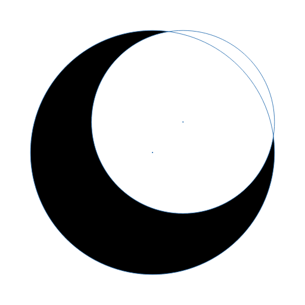
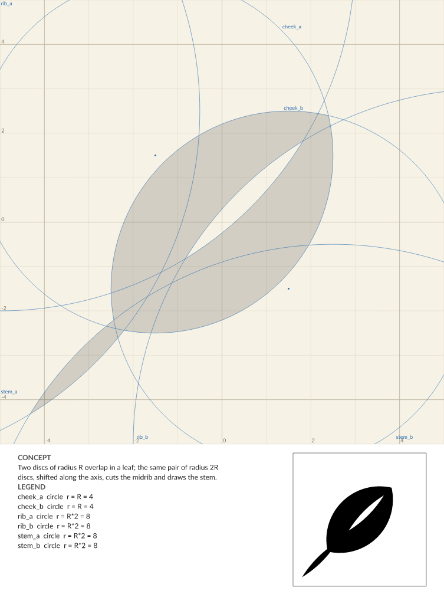
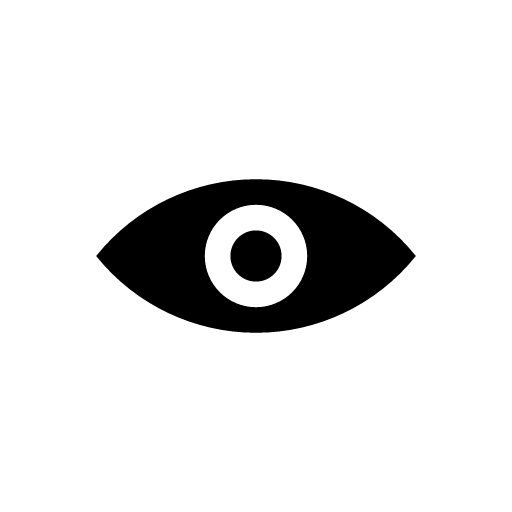
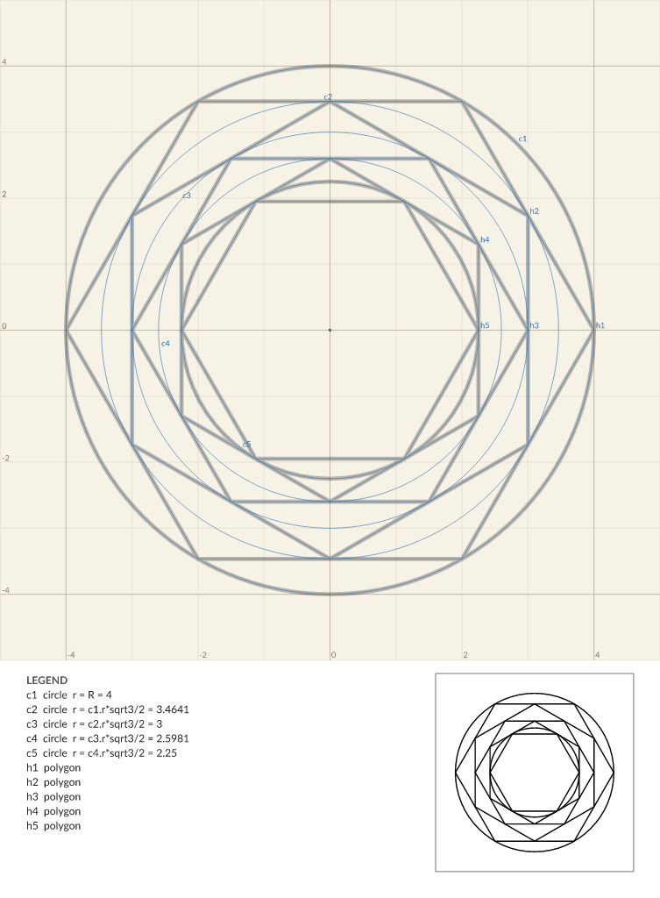

# gridsmith

**gridsmith draws logo marks and magic-circle figures from a JSON construction spec.** A model declares circles on a grid, tangent circles, lines, arcs and regular polygons; gridsmith solves the geometry, checks it against construction rules (a few radius ratios, a coarse grid, n-fold symmetry) and returns PNG and SVG together with a construction sheet.

It is an MCP server over stdio.

<p></p>

## What's inside

| Tool | Takes | Returns |
|---|---|---|
| `gridsmith_guide` | `topic`: `overview` (default), `spec`, `rules` or `examples` | The cheat sheet, the JSON Schema of a spec, the rule table, or the complete example specs |
| `gridsmith_render` | `spec` (an object, or an absolute path to a JSON file of at most 256 KB), `views` (optional) | A JSON report and the requested views. Writes nothing |
| `gridsmith_export` | `spec`, `dir` (absolute), `name`, `overwrite` (optional) | The files written to `dir` |

**`gridsmith_render`** returns a JSON report (resolved geometry, violations, applied exceptions, near-tangent hints, per-layer statistics, `exportable`) followed by the views in the order requested. PNG views are `sheet` (construction sheet), `final` (512 px), `sizes` (mark only: 64, 32 and 16 px side by side) and `guides` (the final drawing with every construction element over it, 512 px). SVG views are returned as text: `svg`, `sheet_svg` and `guides_svg`. An SVG longer than 60000 characters is not returned; it is listed in `truncated` instead. The default is `sheet` and `sizes` for a mark, `sheet` and `final` for a figure. Rule violations are reported and the drawing is still produced.

**`gridsmith_export`** writes `<name>.svg`, `<name>-sheet.svg`, `<name>-guides.svg`, `<name>.spec.json` and PNGs: `-512`, `-64`, `-32` and `-16` for a mark, `-1024` for a figure. It refuses a spec that still has violations, and refuses when any target file exists unless `overwrite` is true. `dir` is created if missing.

## Installation

Requires Node.js 24 or later and Yarn 4. The package is private and not published to a registry; build it from a checkout.

```sh
yarn install && yarn build
```

Register it with an MCP client. For Claude Code:

```sh
claude mcp add gridsmith -- node /absolute/path/to/gridsmith/dist/index.js
```

## Quick start

1. Call `gridsmith_guide` with `overview`, then `examples` for specs to copy from.
2. Write the spec to a JSON file with an absolute path, for example `/tmp/work/mark.json`.
3. Call `gridsmith_render` with `spec` set to that path. Read the report and the images, edit the file, and render again.
4. When `violations` is empty (`exportable` is true), call `gridsmith_export` with `dir`, `name` and the same spec path.

## Build from source

```sh
yarn test      # Vitest
yarn check     # Biome and tsc --noEmit
yarn gallery   # rebuilds docs/gallery/ from the examples in src/guide/examples.ts
```

The files in `docs/gallery/` are generated; do not edit them by hand.

## How a spec is built

A spec has `version` (1), `mode`, `grid`, `shapes`, `paint`, and optionally `concept` and `exceptions`. `gridsmith_guide` with `spec` returns the exact schema.

**Grid and coordinates.** `grid.divisions` is 4, 6 or 8 and sets R, the radius of the unit circle in modules. `grid.margin` is 0 to 4 modules (default 1), so the canvas is a square of half side R + margin. The origin is the canvas centre, x points right and y up. Angles are degrees counter-clockwise from +x.

**Elements** (`shapes`, at most 64; each refers only to earlier ones).

| Kind | Meaning |
|---|---|
| `point` | A named point |
| `circle` | `center` (default [0, 0]) and `r` |
| `tangent_circle` | The circle of radius `r` touching both elements in `to` (circles or lines); `near` picks among the candidates |
| `line` | Infinite line through `from` and `to`; drawn as that segment when stroked |
| `arc` | Part of circle `on`, counter-clockwise from `from` to `to` (degrees or points on the circle) |
| `polygon` | Regular `n`-gon inscribed in circle `in`; `step` of 2 or more gives a star; `rotate` in degrees |
| `points` | Closed polygon through listed points |
| `repeat` | `n` rotated copies of `of` about `center`; `mirror` adds the reflection across the line at angle `axis` |

**Length.** A number from 0.05 to 64 modules, or an expression: `R` or `<circle id>.r`, followed by `*` or `/` with 2 to 16, `sqrt2`, `sqrt3`, `phi` or `phi2`. For example `"R/2"` or `"outer.r*sqrt3/2"`. No spaces, parentheses, `+` or `-`.

**Point.** `[x, y]`; the id of a point or circle (its centre); `{ "on": circle, "angle": degrees }`; or `{ "intersect": [a, b], "near": point }`, where `near` picks the candidate closest to the point given and may be omitted when there is only one.

**mark** paints filled regions: `paint: [{ "fill": Region, "color": "#rrggbb" }]`. A Region is an id (a circle, polygon, points or a repeat of those), `{ "half": line, "toward": point }` for a half-plane, or `{ "union" | "intersect" | "subtract": [Region, ...] }`. A region must be bounded.

**figure** paints strokes: `{ "stroke": [ids], "width": Length, "color": ... }`. Circles draw as circumferences, lines as segments, arcs as partial circumferences, polygons as outlines and a repeat as every copy. An `{ "erase": [ids] }` layer (never first) hides every earlier layer inside the listed circles, polygons or points, so later layers can draw medallions over bands. Circles that nothing strokes may serve as helpers.

A mark and a figure never mix: a mark takes only `fill` layers, a figure only `stroke` and `erase`. A violation can be excused with an `exceptions` entry `{ rule, target, reason }`; the reason is printed on the construction sheet.

### Rules

| Rule | Meaning |
|---|---|
| `ratio_count` | At most 3 distinct ratios across radii and widths; "R/2" and "R*2" count once |
| `circle_count` | At most 8 circles in a mark, 16 in a figure; arcs do not count |
| `off_grid` | Numeric coordinates and radii are multiples of 0.5 module (mark) or 0.25 (figure) |
| `angle` | Angles are multiples of 180/n for n in 2, 3, 4, 5, 6, 8, 10, 12, 20, 24; `polygon.n` and `repeat.n` come from the same set |
| `off_canvas` | Everything drawn stays inside the canvas |
| `empty_fill` | A fill layer produces at least one closed outline (mark) |
| `thin_stroke` | A stroke is at least 1 px wide with the canvas drawn at 512 px (figure) |
| `unused_shape` | Every element is reachable from a paint layer |
| `unused_exception` | An exception that matches no violation is reported; it cannot itself be excused |

## Gallery

Each example is a complete spec that passes every rule. For each, the finished drawing is on the left and the construction sheet (grid, construction circles and lines, legend) on the right. The files are under `docs/gallery/`, including SVGs.

### mark

#### crescent

<p> </p>

A crescent cut from one disc by a second disc. `body` has radius R (4 modules); `bite` has radius 3 and its centre is offset to [1, 1]. The fill is `body` minus `bite`.

<p></p>

Spec: [`docs/gallery/crescent.json`](docs/gallery/crescent.json)

#### leaf

<p> </p>

Two discs of radius R centred at [-1.5, 1.5] and [1.5, -1.5] overlap in a lens, which is the leaf. A second pair of discs of radius R*2 (shifted along the same axis) is intersected and subtracted from the lens as the midrib. A third pair of R*2 discs, intersected, forms the stem and is united with the leaf. The spec uses two ratios, R and R*2.

Spec: [`docs/gallery/leaf.json`](docs/gallery/leaf.json)

#### taiji

<p> </p>

`upper` and `lower` are tangent_circles of radius R/2, each touching the disc and the horizontal line, found near [0, 2] and [0, -2]. The right half of the disc (a half-plane through the vertical line, intersected with the disc) is united with `upper` and has `lower` subtracted, which draws the S-curve. A dot of radius 0.5 is cut out of the upper half and added back in the lower half.

<p></p>

Spec: [`docs/gallery/taiji.json`](docs/gallery/taiji.json)

#### open-ring

<p> </p>

Concentric discs of radius R (4) and 3 make a ring, and a core disc of radius 1 sits at the centre. Two lines from the centre to the outer circle at +30 and -30 degrees bound a wedge, built as the intersection of two half-planes, and it is subtracted from the ring to open a 60 degree gap on the right.

Spec: [`docs/gallery/open-ring.json`](docs/gallery/open-ring.json)

#### eye

<p> </p>

Two discs of radius R centred at [0, -2.5] and [0, 2.5] intersect in a lens. A disc of radius 1 is subtracted from it as the iris, and a disc of radius 0.5 is united back as the pupil.

Spec: [`docs/gallery/eye.json`](docs/gallery/eye.json)

### figure

#### hexagram-circle

<p> </p>

Circles of radius R, 3, and R/2 are stroked, with a helper circle of radius 3.5 that is not stroked. A hexagram is the polygon {6/2} (`n: 6`, `step: 2`) inscribed in the radius 3 circle. A small circle of radius 0.25 sits on the helper circle at angle 0 and is repeated 12 times, 30 degrees apart.

Spec: [`docs/gallery/hexagram-circle.json`](docs/gallery/hexagram-circle.json)

#### pentagram

<p> </p>

The pentagram is {5/2} inscribed in the radius 3.5 `ring`. `core` has radius `ring.r/phi2`, which is the ring radius divided by the golden ratio squared, and holds a pentagon turned upside down. A pentagon inscribed in the outer circle frames the figure, and five small circles repeat around the ring at the star points.

<p></p>

Spec: [`docs/gallery/pentagram.json`](docs/gallery/pentagram.json)

#### sigil-medallions

<p> </p>

The grid has 8 divisions, so R is 8. Concentric double-line bands (a1/a2, c1/c2, d1/d2) surround a ring of radial ticks, drawn as two repeats of 24 ticks offset by 7.5 degrees. Inside are two squares, one inscribed in `sq_a` and one in `sq_b` (`sq_a.r/sqrt2`) turned 45 degrees, and two triangles, with `tri_b` at `tri_a.r/2`. Eight medallions (four of radius 1.75 and four of radius 1, repeated every 90 degrees) are an erase layer that hides the bands behind them; they are stroked again on top and each holds a star or a square. The spec uses two ratios, 1/sqrt2 and 1/2.

<p></p>

Spec: [`docs/gallery/sigil-medallions.json`](docs/gallery/sigil-medallions.json)

#### crescent-moon

<p> </p>

The moon (radius R) and a second circle `bite` (radius 3.5, centre [1.5, 0]) intersect in two points, `horn_top` and `horn_low`. The outline is two arcs between them, `outer_edge` on the moon and `inner_edge` on `bite`, each running counter-clockwise from `horn_top` to `horn_low`. A small circle is drawn beside the crescent.

Spec: [`docs/gallery/crescent-moon.json`](docs/gallery/crescent-moon.json)

#### petal-rosette

<p> </p>

Two circles of radius 2.5 centred at [2, 1.5] and [2, -1.5] intersect at `base` (near the origin) and `tip` (near [4, 0]). One petal is two arcs between those points, one on each circle. The petal is repeated 8 times about the centre, and a hub circle and the frame circle are stroked at different widths.

<p></p>

Spec: [`docs/gallery/petal-rosette.json`](docs/gallery/petal-rosette.json)

#### hexagon-rosette

<p> </p>

Each circle is the previous one scaled by `sqrt3/2`, the apothem ratio of a hexagon, so every hexagon inscribed in a circle has its edge midpoints on the next smaller circle. Alternate hexagons are turned 30 degrees. The whole figure uses a single ratio.

Spec: [`docs/gallery/hexagon-rosette.json`](docs/gallery/hexagon-rosette.json)

## Non-goals

gridsmith draws geometry only. It does not render text: finished drawings contain no glyphs.
