# gridsmith

**gridsmith draws logo marks, magic-circle figures and 24-unit UI icons from a JSON construction spec.** A model declares circles on a grid, tangent circles, lines, arcs, regular polygons and, for icons, polylines, rectangles and ovals; gridsmith solves the geometry, checks it against construction rules (a few radius ratios, a coarse grid, n-fold symmetry) and returns PNG and SVG together with a construction sheet.

It is an MCP server over stdio.

<p>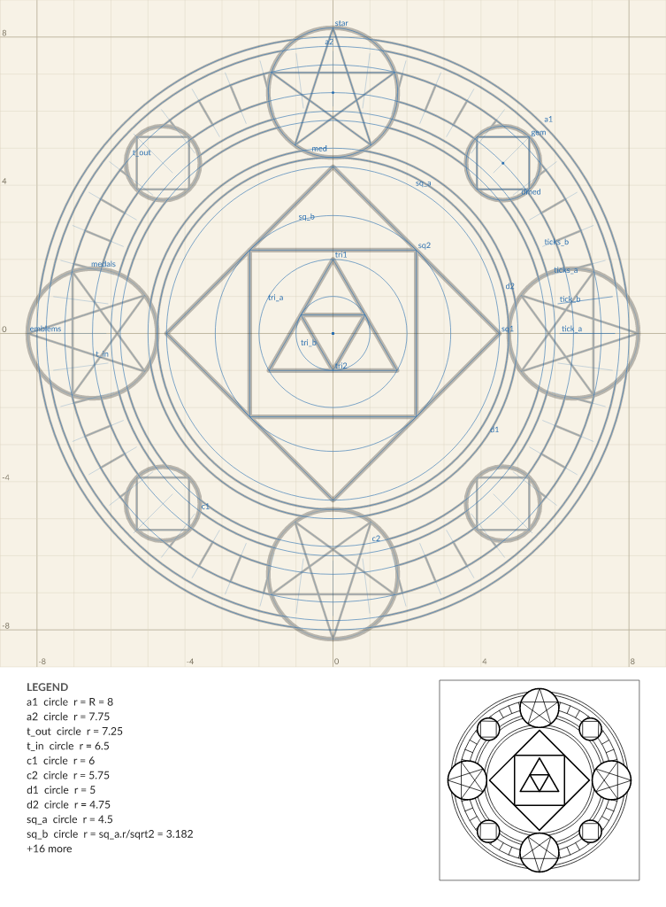</p>

## What's inside

| Tool | Takes | Returns |
|---|---|---|
| `gridsmith_guide` | `topic`: `overview` (default), `spec`, `rules`, `examples` or `icon` | The cheat sheet, the JSON Schema of a spec, the rule table, the complete example specs, or the icon-mode reference |
| `gridsmith_render` | `spec` (an object, or an absolute path to a JSON file of at most 256 KB), `views` and `underlay` (both optional) | A JSON report and the requested views. Writes nothing |
| `gridsmith_export` | `spec`, `dir` (absolute), `name`, `overwrite` (optional) | The files written to `dir` |
| `gridsmith_import` | `segments` (1 to 64 path segments of an icon), `snap` (optional, default true), `step` (optional: 0.5, 0.25 or 0.1) | An icon spec, its status, violations and the pixel difference from the original. Writes nothing |

**`gridsmith_render`** returns a JSON report (resolved geometry, violations, applied exceptions, near-tangent hints, per-layer statistics, `exportable`) followed by the views in the order requested. PNG views are `sheet` (construction sheet), `final` (512 px), `sizes` (a mark: 64, 32 and 16 px side by side; an icon: a pixel preview, see below; not for a figure), `guides` (the final drawing with every construction element over it, 512 px) and `match` (the drawing against an `underlay` image, 512 px; see below). SVG views are returned as text: `svg`, `sheet_svg` and `guides_svg`. An icon also has `segments`, its path data as a JSON string. A text view longer than 60000 characters is not returned; it is listed in `truncated` instead. The default is `sheet` and `sizes` for a mark or an icon, `sheet` and `final` for a figure. Rule violations are reported and the drawing is still produced.

**`gridsmith_export`** writes `<name>.svg`, `<name>-sheet.svg`, `<name>-guides.svg`, `<name>.spec.json` and PNGs: `-512`, `-64`, `-32` and `-16` for a mark, `-1024` for a figure, `-512`, `-48`, `-24` and `-16` for an icon. An icon also gets `<name>.segments.json`; see Icons. It refuses a spec that still has violations, and refuses when any target file exists unless `overwrite` is true. `dir` is created if missing.

## Installation

Requires Node.js 24 or later and Yarn 4. The package is private and not published to a registry; build it from a checkout.

```sh
yarn install && yarn build
```

Register it with an MCP client. For Claude Code:

```sh
claude mcp add gridsmith -- node /absolute/path/to/gridsmith/dist/index.js
```

## Quick start

1. Call `gridsmith_guide` with `overview`, then `examples` for specs to copy from.
2. Write the spec to a JSON file with an absolute path, for example `/tmp/work/mark.json`.
3. Call `gridsmith_render` with `spec` set to that path. Read the report and the images, edit the file, and render again.
4. When `violations` is empty (`exportable` is true), call `gridsmith_export` with `dir`, `name` and the same spec path.

## Build from source

```sh
yarn test      # Vitest
yarn check     # Biome and tsc --noEmit
yarn gallery   # rebuilds docs/gallery/ from the examples in src/guide/examples.ts
```

The files in `docs/gallery/` are generated; do not edit them by hand.

## How a spec is built

A spec has `version` (1), `mode`, `grid`, `shapes`, `paint`, and optionally `concept` and `exceptions`. `gridsmith_guide` with `spec` returns the exact schema.

**Grid and coordinates.** `grid.divisions` is 4, 6 or 8 (12 for an icon) and sets R, the radius of the unit circle in modules. `grid.margin` is 0 to 4 modules (default 1; an icon takes only 0, its default), so the canvas is a square of half side R + margin. An icon may set `grid.step` to 0.5 (the default), 0.25 or 0.1: the step its numeric coordinates and radii sit on. The origin is the canvas centre, x points right and y up. Angles are degrees counter-clockwise from +x.

**Elements** (`shapes`, at most 256; each refers only to earlier ones).

| Kind | Meaning |
|---|---|
| `point` | A named point |
| `circle` | `center` (default [0, 0]) and `r` |
| `tangent_circle` | The circle of radius `r` touching both elements in `to` (circles or lines); `near` picks among the candidates |
| `line` | Infinite line through `from` and `to`; drawn as that segment when stroked |
| `arc` | Part of circle or oval `on`, counter-clockwise from `from` to `to` (degrees or points on a circle; degrees only on an oval) |
| `polygon` | Regular `n`-gon inscribed in circle `in`; `step` of 2 or more gives a star; `rotate` in degrees |
| `points` | Closed polygon through listed points |
| `outline` | One closed edge cut from circles and lines declared earlier, joined by tangency or at chosen corners; see below |
| `polyline` | Open polyline through 3 to 32 points; stroke layers only |
| `rect` | Axis-parallel rectangle between two opposite `corners`; `r` rounds all four corners |
| `oval` | Oval of semi-axes `rx` and `ry` whose outline follows the true ellipse as 28 circular arcs, within 0.06% of the longer semi-axis, turned by `rotate` degrees; the ratio is at most 4 |
| `repeat` | `n` rotated copies of `of` about `center`; `mirror` adds the reflection across the line at angle `axis` |

**Length.** A number from 0.05 to 64 modules, or an expression: `R` or `<circle id>.r`, followed by `*` or `/` with 2 to 16, `sqrt2`, `sqrt3`, `phi` or `phi2`. For example `"R/2"` or `"outer.r*sqrt3/2"`. No spaces, parentheses, `+` or `-`.

**Point.** `[x, y]`; the id of a point or circle (its centre); `{ "on": circle, "angle": degrees }`; or `{ "intersect": [a, b], "near": point }`, where `near` picks the candidate closest to the point given and may be omitted when there is only one.

**mark** paints filled regions: `paint: [{ "fill": Region, "color": "#rrggbb" }]`. A Region is an id (a circle, polygon, points, outline or a repeat of those), `{ "half": line, "toward": point }` for a half-plane, or `{ "union" | "intersect" | "subtract": [Region, ...] }`. A region must be bounded.

**figure** paints strokes: `{ "stroke": [ids], "width": Length, "color": ..., "cap"?, "join"?, "dash"? }`. Circles draw as circumferences, lines as segments, arcs as partial circumferences, polygons as outlines and a repeat as every copy. An `{ "erase": [ids] }` layer (never first) hides every earlier layer inside the listed circles, polygons or points, so later layers can draw medallions over bands. Circles that nothing strokes may serve as helpers.

**Stroke options** (stroke layers of a figure or an icon): `cap` is `"round"` (default), `"butt"` or `"square"`; `join` is `"round"` (default), `"miter"` or `"bevel"`; `dash` is `[length, gap]` in modules, and a stroke is solid without it. A dash starts at the first point of the element, in the order it is written; a circle starts at its rightmost point and runs clockwise.

A mark takes only `fill` layers, a figure only `stroke` and `erase`, and an icon `fill` and `stroke` in any order (no `erase`). A violation can be excused with an `exceptions` entry `{ rule, target, reason }`; the reason is printed on the construction sheet.

### Rules

| Rule | Meaning |
|---|---|
| `ratio_count` | At most 3 distinct ratios across radii and widths; "R/2" and "R*2" count once. Not applied to an icon |
| `circle_count` | At most 8 circles in a mark, 16 in a figure, 40 in an icon; arcs do not count. A mark whose fill reaches an `outline` may have 40 |
| `off_grid` | Numeric coordinates and radii are multiples of 0.5 module (mark), 0.25 (figure) or `grid.step` (icon, default 0.5); stroke widths and `dash` are exempt |
| `angle` | Angles, including `oval.rotate`, are multiples of 180/n for n in 2, 3, 4, 5, 6, 8, 10, 12, 20, 24; `polygon.n` and `repeat.n` come from the same set |
| `off_canvas` | Everything drawn stays inside the canvas; a stroke counts half its width beyond its geometry |
| `empty_fill` | A fill layer produces at least one closed outline (mark, icon) |
| `thin_stroke` | A stroke is at least 1 px wide with the canvas drawn at 512 px (figure), or at least 0.5 module wide (icon) |
| `uneven_steps` | A polyline of 3 or more segments that rises or falls steadily along one axis has equal steps along that axis (figure, icon). A polyline with a segment that stays level on the other axis is not checked |
| `width_count` | At most 3 distinct stroke widths in one spec (icon) |
| `unused_shape` | Every element is reachable from a paint layer |
| `unused_exception` | An exception that matches no violation is reported; it cannot itself be excused |

### Outlines and underlay

**`outline`** draws a figurative silhouette from construction circles instead of coordinates. `through` lists 2 to 64 pieces counter-clockwise, with the inside on the left. A piece is an id, or `{ "on": id, "concave": true, "corner": point }`; `on` is a circle, `tangent_circle` or `line`. A circle piece bulges outward, and `concave: true` carves inward. Each piece ends where it meets the next one, and the last meets the first. Pieces that touch are joined at the tangent point. Pieces that cross are joined at a corner, and `corner` picks which of the two intersections. An outline works where `points` does: as a mark fill, a figure stroke or erase, or in a `repeat`. The report's `geometry` lists its pieces, its corners with the signed turn in degrees (left turns positive) and its area.

**`underlay`** compares a drawing with a reference image. Pass `underlay: { "path": ..., "box"?, "threshold"?, "invert"?, "fit"? }` to `gridsmith_render`. `path` is an absolute path to a PNG or JPEG of at most 4 MiB and 16 million pixels. The foreground is found from the alpha channel, or from luminance with an Otsu threshold (`threshold` 1 to 254 overrides it, `invert` swaps the sides). Its bounding box is fitted into `box` (modules, default the grid square) and the sheet shows it in orange behind the drawing. `fit` is `"shape"` (default) or `"image"`; `"image"` places the whole image in `box` instead of its foreground, which suits a PNG of a whole 24-unit canvas. Every opaque pixel counts as ink, so cut a hole with `subtract` instead of painting it white.

With an underlay the report gains `match`: `iou` (1 means identical), `missing` and `excess` as shares, `offset` (drawing centre minus reference centre), `grid` (12 rows, top first: `-` missing, `+` excess, `.` fine), up to three `blobs` (kind, share of the reference area, centre, box) and `underlay` (the placement, threshold and polarity used). The `match` view is a 512 px PNG: both in dark grey, reference only in orange, drawing only in blue. Fix the largest blob or grid region and render again. Compare a figure with a line drawing, not with a filled silhouette. `gridsmith_export` does not take an underlay.

## Icons

`mode: "icon"` draws a 24-unit UI icon with `grid.divisions` 12 and no margin: one module is one pixel at 24 px. Coordinates keep the origin at the centre with y up and range over -12 to 12. To use them as SVG coordinates (0 to 24, y down) take `x + 12` and `12 - y`. `paint` mixes `fill` and `stroke` layers in any order, and a later layer lies on top. To fill and outline the same shape, write one layer of each. Elements that share a vertex, such as the filled dot at the end of a polyline, refer to one `point` by id. `gridsmith_guide` with `icon` returns the full reference.

<p>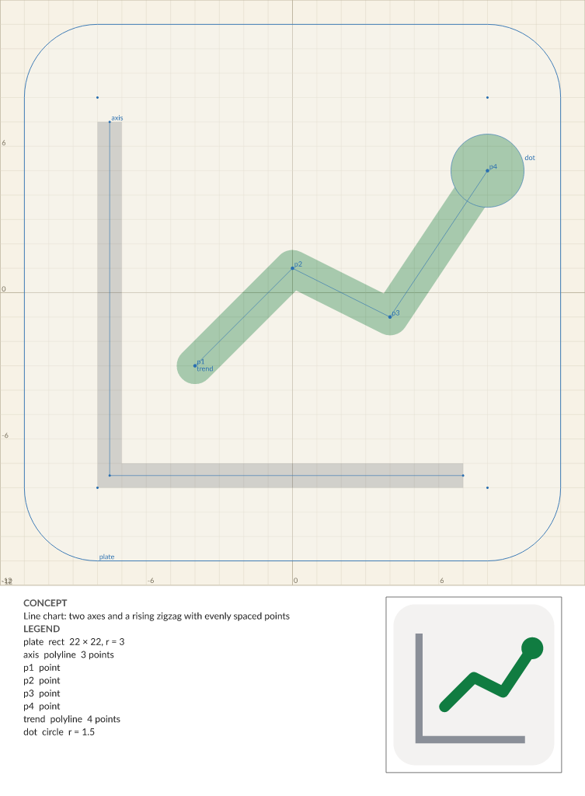 </p>

The `sizes` view of an icon draws the final SVG at 24 px and at 16 px on white and enlarges both 8x with nearest-neighbour sampling (336 x 192 px), so each pixel is visible. The `segments` view and `gridsmith_export` give `<name>.segments.json`: the path data of the icon, one segment per paint layer in paint order, in a 24-unit canvas with the origin at the top left and y down. Each segment has `d` (absolute `M`, `L`, `A` and `Z` commands) and either `fill` and `fillRule`, or `stroke`, `strokeWidth`, `strokeLinecap`, `strokeLinejoin` and, for a dashed stroke, `strokeDasharray`. A consumer that renders one `path` element per segment draws the same picture as the final SVG.

```json
{ "canvas": 24,
  "segments": [
    { "d": "M2 5L22 5L22 19L2 19Z", "fill": "#ffffff", "fillRule": "evenodd" },
    { "d": "M4 15L8 11L12 14L16 8", "stroke": "#107c41", "strokeWidth": 1.3,
      "strokeLinecap": "round", "strokeLinejoin": "round" }
  ] }
```

`gridsmith_import` takes segments of this shape from an existing icon and returns a spec. Curves become lines and circular arcs within 0.025 units (0.05 or 0.1 when a finer fit needs more than 40 circles), and a single elliptical arc becomes an arc on an oval. A filled closed path of lines and circular arcs becomes an `outline` with its support circles and lines; when the path is not stroked, one whose lines cross becomes an outline per loop, and an arc that turns back at both ends becomes its chord less its circle. A filled path with elliptical arcs becomes its chords united with, or less, the `oval`s of those arcs (its stroke drawn as lines and `arc`s on those ovals). The cut, capped and oval forms are used only when they fill the same area as the source. The spec is then rounded to a grid step, `step` or else the one whose drawing stays closest to the original (returned as `snap.step`). Polylines evenly stepped in the source get equal steps, the others keep theirs with an `uneven_steps` exception (`snap: false` skips the rounding). `status` is `clean`, `violations`, `partial` (some subpaths were skipped; a skipped path of mixed lines and arcs lists them in `pieces`, with `detail` when it could not become an outline) or `failed`. `diff` is the share of pixels that differ from the original; `faithful` is the same share before rounding.

## Gallery

Each example is a complete spec that passes every rule. For each, the finished drawing is on the left and the construction sheet (grid, construction circles and lines, legend) on the right. The files are under `docs/gallery/`, including SVGs.

### mark

#### crescent

<p>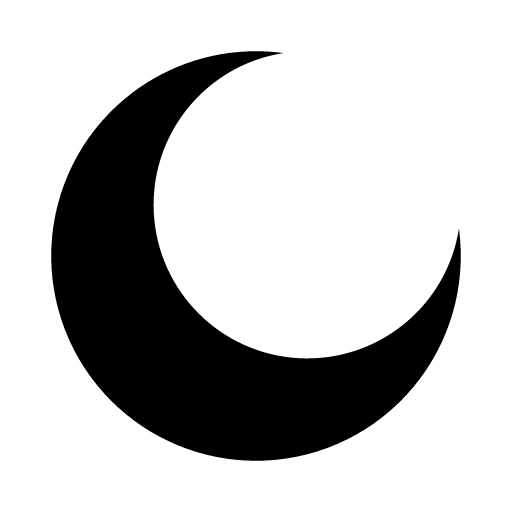 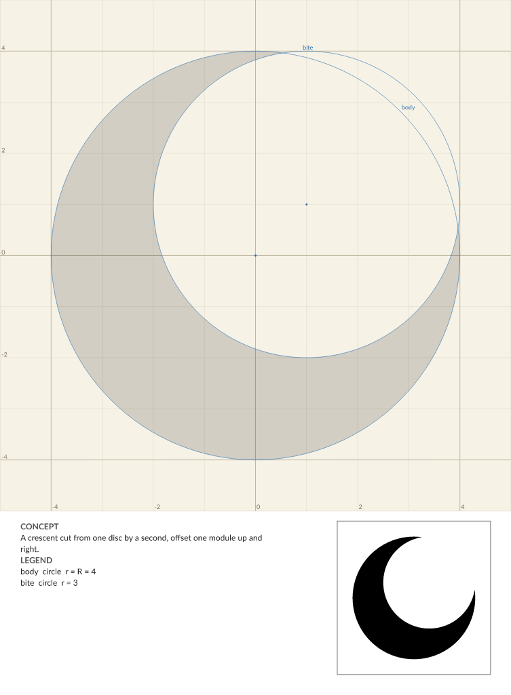</p>

A crescent cut from one disc by a second disc. `body` has radius R (4 modules); `bite` has radius 3 and its centre is offset to [1, 1]. The fill is `body` minus `bite`.

<p></p>

Spec: [`docs/gallery/crescent.json`](docs/gallery/crescent.json)

#### leaf

<p>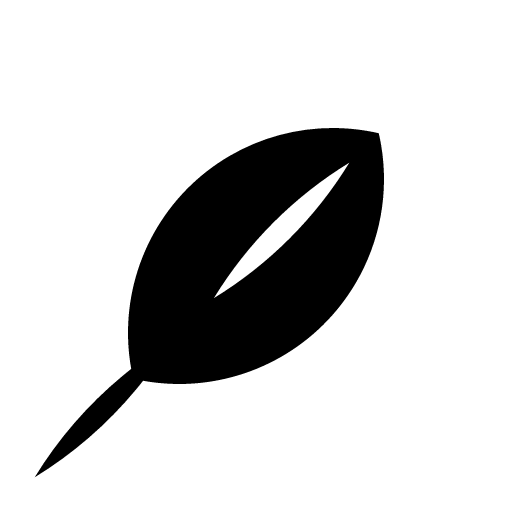 </p>

Two discs of radius R centred at [-1.5, 1.5] and [1.5, -1.5] overlap in a lens, which is the leaf. A second pair of discs of radius R*2 (shifted along the same axis) is intersected and subtracted from the lens as the midrib. A third pair of R*2 discs, intersected, forms the stem and is united with the leaf. The spec uses two ratios, R and R*2.

Spec: [`docs/gallery/leaf.json`](docs/gallery/leaf.json)

#### taiji

<p>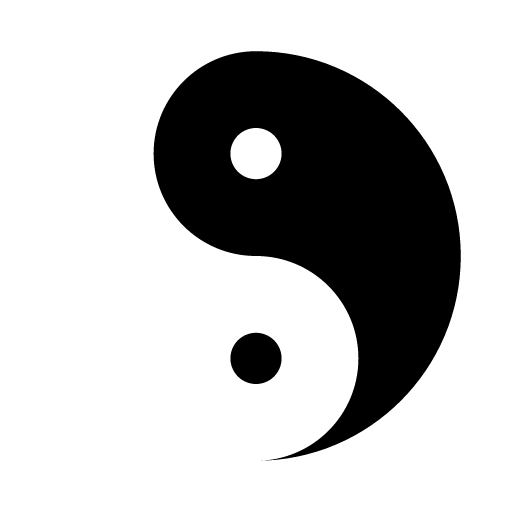 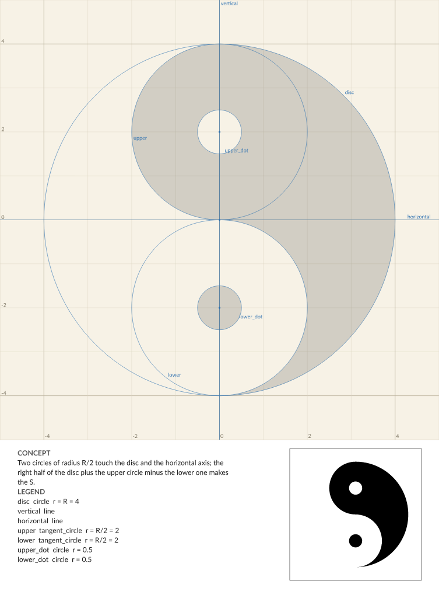</p>

`upper` and `lower` are tangent_circles of radius R/2, each touching the disc and the horizontal line, found near [0, 2] and [0, -2]. The right half of the disc (a half-plane through the vertical line, intersected with the disc) is united with `upper` and has `lower` subtracted, which draws the S-curve. A dot of radius 0.5 is cut out of the upper half and added back in the lower half.

<p>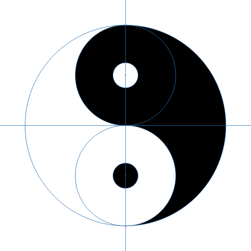</p>

Spec: [`docs/gallery/taiji.json`](docs/gallery/taiji.json)

#### open-ring

<p>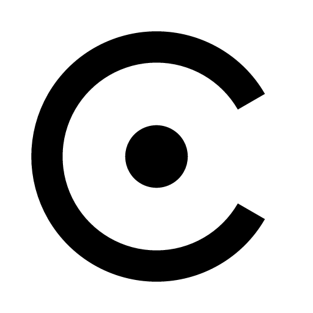 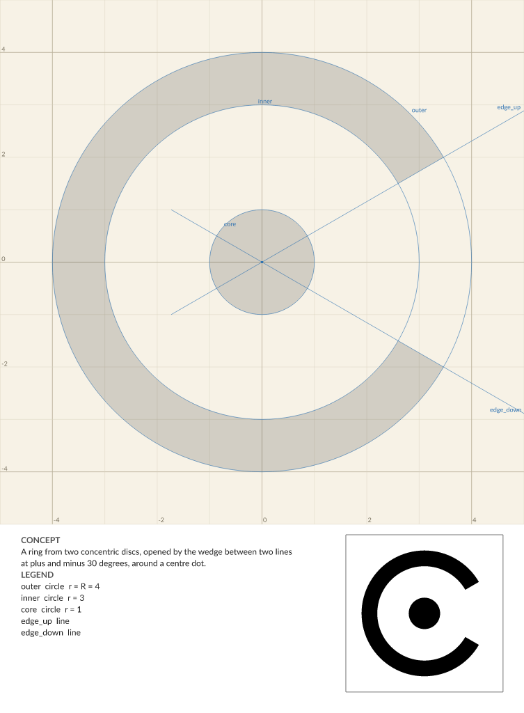</p>

Concentric discs of radius R (4) and 3 make a ring, and a core disc of radius 1 sits at the centre. Two lines from the centre to the outer circle at +30 and -30 degrees bound a wedge, built as the intersection of two half-planes, and it is subtracted from the ring to open a 60 degree gap on the right.

Spec: [`docs/gallery/open-ring.json`](docs/gallery/open-ring.json)

#### eye

<p> 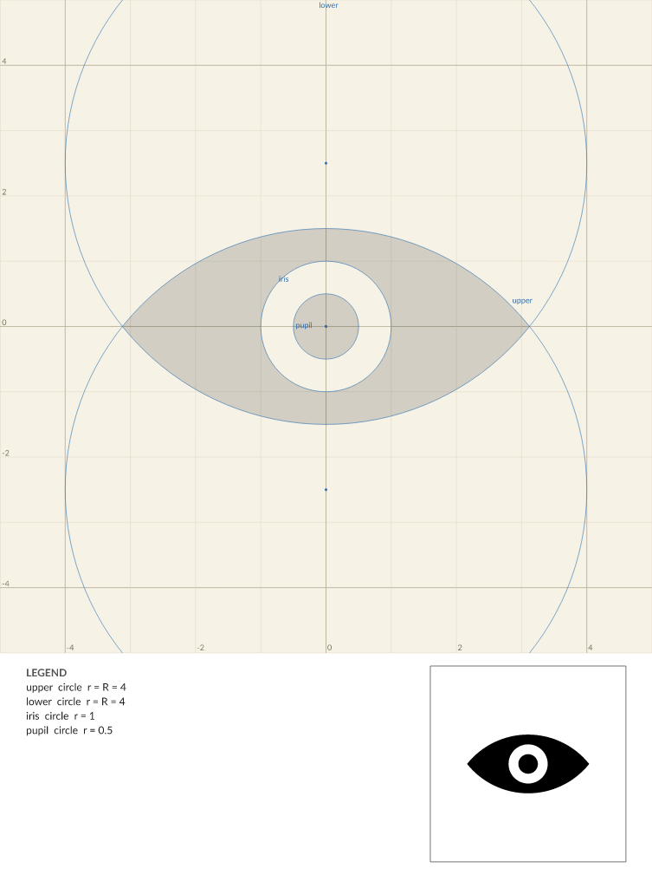</p>

Two discs of radius R centred at [0, -2.5] and [0, 2.5] intersect in a lens. A disc of radius 1 is subtracted from it as the iris, and a disc of radius 0.5 is united back as the pupil.

Spec: [`docs/gallery/eye.json`](docs/gallery/eye.json)

#### whale

<p>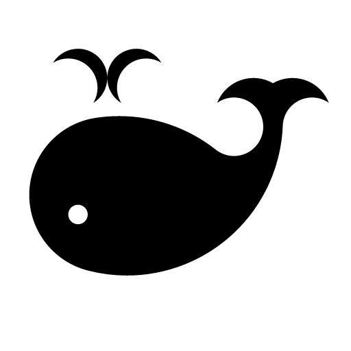 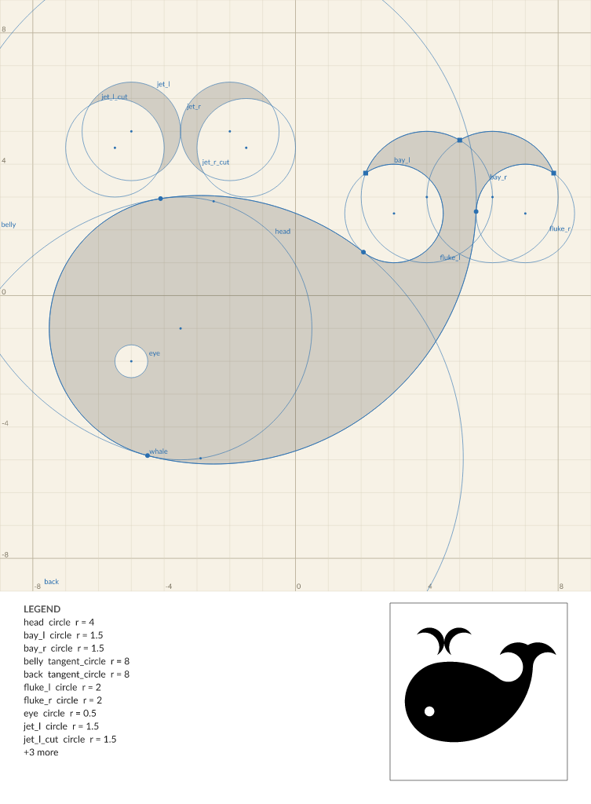</p>

A whale silhouette from a single `outline` through seven circles on an 8-division grid. `head` is a round circle; `belly` and `back` are tangent circles of radius 8 that each touch the head from inside and one bay from outside, so the body tapers to the tail without a corner. `fluke_l` and `fluke_r` meet at corners, and `bay_l` and `bay_r` are carved in (`concave`). A disc of radius 0.5 is subtracted as the eye, and the spout is two crescents, each a disc minus a disc. To fit a shape like this to a picture, render it with `underlay` set to the picture and read `match`.

<p>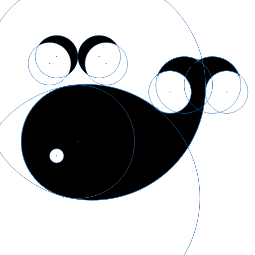</p>

Spec: [`docs/gallery/whale.json`](docs/gallery/whale.json)

### icon

#### line-chart

<p> </p>

A rounded `rect` plate (radius 3) is filled, then two stroke layers are drawn over it: the axes, a `polyline` with mitred joins and butt caps, and a rising zigzag through four `point` elements spaced 4 modules apart in x. The dot at the end is a filled circle of radius 1.5 centred on the last point, so the polyline and the dot share it by id.

<p> 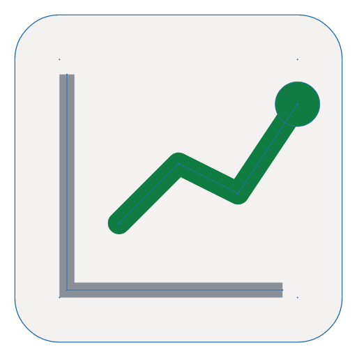</p>

Spec: [`docs/gallery/line-chart.json`](docs/gallery/line-chart.json)

### figure

#### hexagram-circle

<p>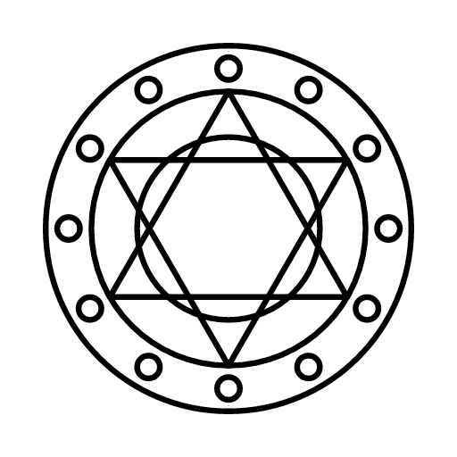 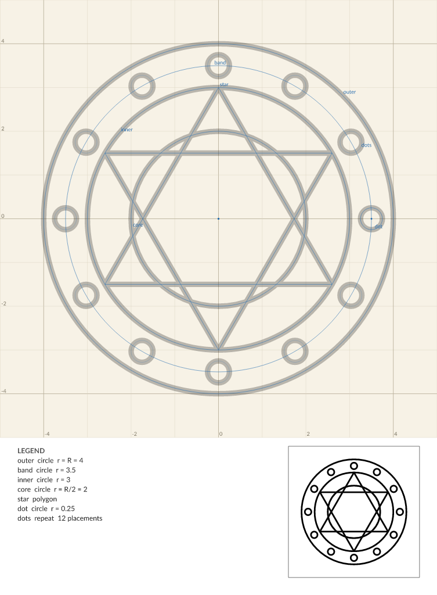</p>

Circles of radius R, 3, and R/2 are stroked, with a helper circle of radius 3.5 that is not stroked. A hexagram is the polygon {6/2} (`n: 6`, `step: 2`) inscribed in the radius 3 circle. A small circle of radius 0.25 sits on the helper circle at angle 0 and is repeated 12 times, 30 degrees apart.

Spec: [`docs/gallery/hexagram-circle.json`](docs/gallery/hexagram-circle.json)

#### pentagram

<p>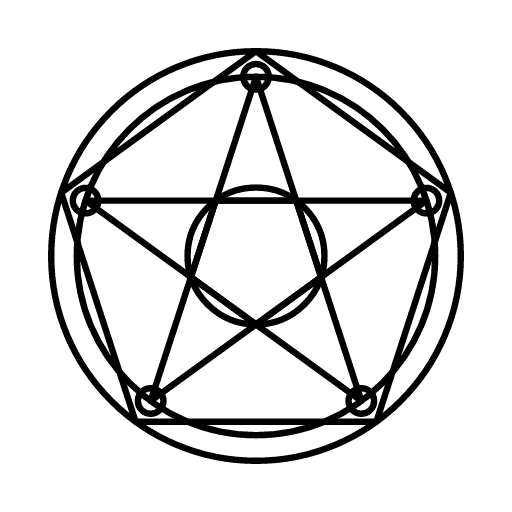 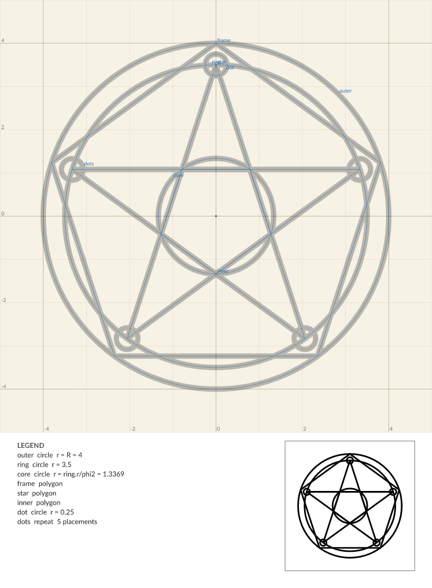</p>

The pentagram is {5/2} inscribed in the radius 3.5 `ring`. `core` has radius `ring.r/phi2`, which is the ring radius divided by the golden ratio squared, and holds a pentagon turned upside down. A pentagon inscribed in the outer circle frames the figure, and five small circles repeat around the ring at the star points.

<p>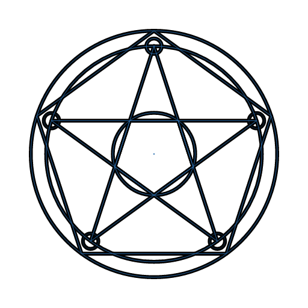</p>

Spec: [`docs/gallery/pentagram.json`](docs/gallery/pentagram.json)

#### sigil-medallions

<p>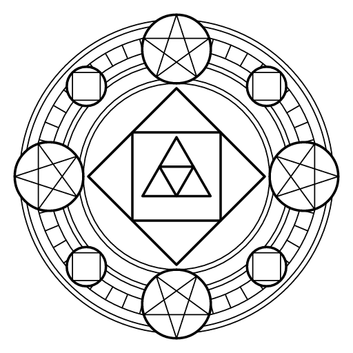 </p>

The grid has 8 divisions, so R is 8. Concentric double-line bands (a1/a2, c1/c2, d1/d2) surround a ring of radial ticks, drawn as two repeats of 24 ticks offset by 7.5 degrees. Inside are two squares, one inscribed in `sq_a` and one in `sq_b` (`sq_a.r/sqrt2`) turned 45 degrees, and two triangles, with `tri_b` at `tri_a.r/2`. Eight medallions (four of radius 1.75 and four of radius 1, repeated every 90 degrees) are an erase layer that hides the bands behind them; they are stroked again on top and each holds a star or a square. The spec uses two ratios, 1/sqrt2 and 1/2.

<p>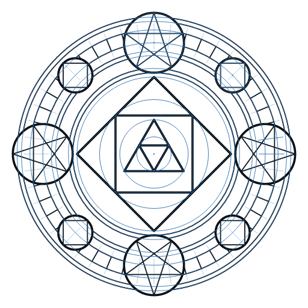</p>

Spec: [`docs/gallery/sigil-medallions.json`](docs/gallery/sigil-medallions.json)

#### crescent-moon

<p>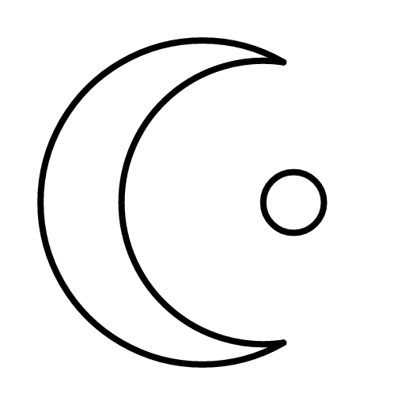 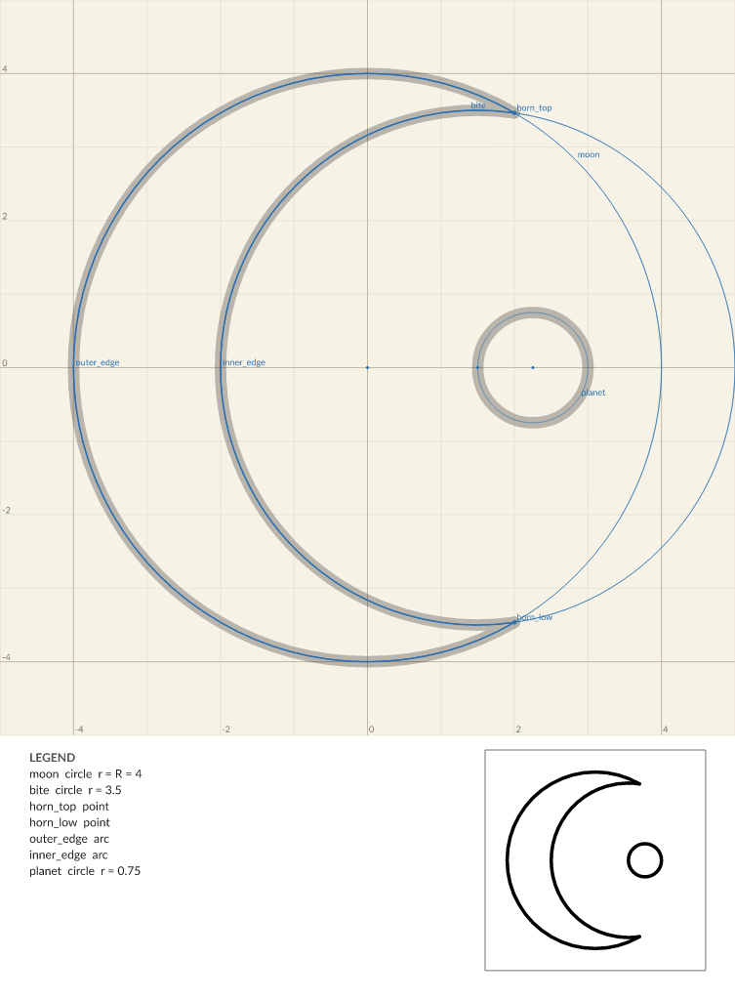</p>

The moon (radius R) and a second circle `bite` (radius 3.5, centre [1.5, 0]) intersect in two points, `horn_top` and `horn_low`. The outline is two arcs between them, `outer_edge` on the moon and `inner_edge` on `bite`, each running counter-clockwise from `horn_top` to `horn_low`. A small circle is drawn beside the crescent.

Spec: [`docs/gallery/crescent-moon.json`](docs/gallery/crescent-moon.json)

#### petal-rosette

<p>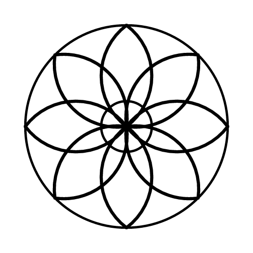 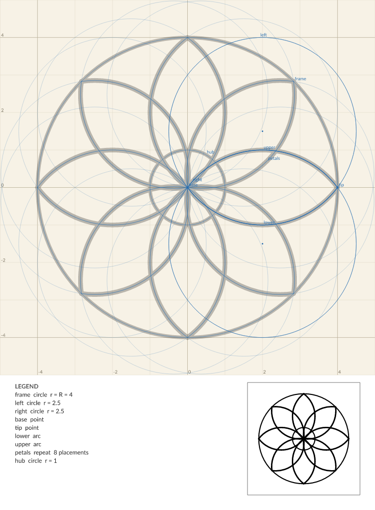</p>

Two circles of radius 2.5 centred at [2, 1.5] and [2, -1.5] intersect at `base` (near the origin) and `tip` (near [4, 0]). One petal is two arcs between those points, one on each circle. The petal is repeated 8 times about the centre, and a hub circle and the frame circle are stroked at different widths.

<p>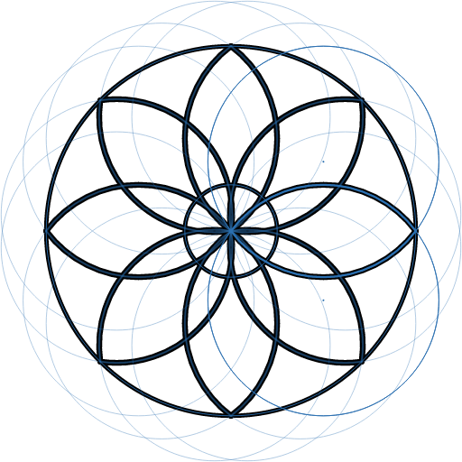</p>

Spec: [`docs/gallery/petal-rosette.json`](docs/gallery/petal-rosette.json)

#### hexagon-rosette

<p>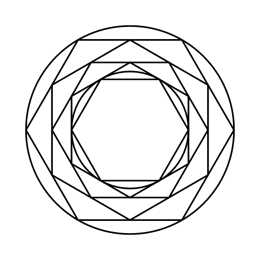 </p>

Each circle is the previous one scaled by `sqrt3/2`, the apothem ratio of a hexagon, so every hexagon inscribed in a circle has its edge midpoints on the next smaller circle. Alternate hexagons are turned 30 degrees. The whole figure uses a single ratio.

Spec: [`docs/gallery/hexagon-rosette.json`](docs/gallery/hexagon-rosette.json)

## Non-goals

gridsmith draws geometry only. It does not render text: finished drawings contain no glyphs.
