# gridsmith

**gridsmith は、JSON の作図仕様からロゴマークと魔法陣の図形を描きます。** モデルがグリッド上の円、接円、線、円弧、正多角形を宣言すると、gridsmith が幾何を解き、作図規則（少数の半径比、粗いグリッド、n 回対称）で検査して、PNG と SVG を構築シートとともに返します。

stdio の MCP サーバーです。

<p></p>

## できること

| ツール | 入力 | 返すもの |
|---|---|---|
| `gridsmith_guide` | `topic`: `overview`（既定）、`spec`、`rules`、`examples` | 早見表、仕様の JSON Schema、規則表、規則を通る完全な例 |
| `gridsmith_render` | `spec`（オブジェクト、または 256 KB 以下の JSON ファイルの絶対パス）、`views` と `underlay`（どちらも省略可） | JSON レポートと指定したビュー。何も書き込みません |
| `gridsmith_export` | `spec`、`dir`（絶対パス）、`name`、`overwrite`（省略可） | `dir` に書き出したファイル |

**`gridsmith_render`** は、JSON レポート（解決済みの幾何、違反、適用済みの例外、近接接触のヒント、レイヤーごとの統計、`exportable`）に続けて、指定した順にビューを返します。PNG ビューは `sheet`（構築シート）、`final`（512 px）、`sizes`（mark のみ。64、32、16 px を並べたもの）、`guides`（完成図に構築要素をすべて重ねたもの、512 px）、`match`（完成図と `underlay` の画像の比較、512 px。後述）です。SVG ビューはテキストで返ります（`svg`、`sheet_svg`、`guides_svg`）。60000 文字を超える SVG は返さず、`truncated` に記載します。既定は mark なら `sheet` と `sizes`、figure なら `sheet` と `final` です。規則違反があっても報告したうえで描画します。

**`gridsmith_export`** は `<name>.svg`、`<name>-sheet.svg`、`<name>-guides.svg`、`<name>.spec.json` と PNG を書き出します。PNG は mark なら `-512`、`-64`、`-32`、`-16`、figure なら `-1024` です。違反が残る仕様は拒否します。出力先に同名のファイルがあるときも、`overwrite` が true でなければ拒否します。`dir` がなければ作成します。

## インストール

Node.js 24 以上と Yarn 4 が必要です。パッケージは private で、レジストリには公開していません。チェックアウトからビルドしてください。

```sh
yarn install && yarn build
```

MCP クライアントに登録します。Claude Code の場合は次のとおりです。

```sh
claude mcp add gridsmith -- node /absolute/path/to/gridsmith/dist/index.js
```

## クイックスタート

1. `gridsmith_guide` を `overview` で呼び、続けて `examples` で手本になる仕様を読みます。
2. 仕様を絶対パスの JSON ファイル（例: `/tmp/work/mark.json`）に書きます。
3. `spec` にそのパスを指定して `gridsmith_render` を呼びます。レポートと画像を確認し、ファイルを直して再度描画します。
4. `violations` が空（`exportable` が true）になったら、`dir`、`name`、同じ仕様のパスを指定して `gridsmith_export` を呼びます。

## ソースからビルド

```sh
yarn test      # Vitest
yarn check     # Biome と tsc --noEmit
yarn gallery   # src/guide/examples.ts の例から docs/gallery/ を再生成
```

`docs/gallery/` のファイルは生成物です。手で編集しないでください。

## 仕様の組み立て方

仕様は `version`（1）、`mode`、`grid`、`shapes`、`paint` と、省略可能な `concept`、`exceptions` からなります。正確なスキーマは `gridsmith_guide` の `spec` で取得できます。

**グリッドと座標。** `grid.divisions` は 4、6、8 のいずれかで、単位円の半径 R（モジュール数）になります。`grid.margin` は 0 から 4 モジュール（既定 1）で、キャンバスは半辺 R + margin の正方形です。原点はキャンバス中心、x は右、y は上向きで、角度は +x から反時計回りの度数です。

**要素**（`shapes`、最大 64 個。参照できるのは先に宣言した要素だけです）。

| 種類 | 内容 |
|---|---|
| `point` | 名前付きの点 |
| `circle` | `center`（既定 [0, 0]）と `r` |
| `tangent_circle` | `to` の2要素（円または線）の両方に接する半径 `r` の円。候補から `near` で選びます |
| `line` | `from` と `to` を通る無限直線。描くときはその区間の線分になります |
| `arc` | 円 `on` の一部。`from` から `to` へ反時計回り（度数、または円上の点） |
| `polygon` | 円 `in` に内接する正 `n` 角形。`step` が 2 以上なら星形、`rotate` は度数 |
| `points` | 指定した点を通る閉じた多角形 |
| `outline` | 先に宣言した円と線から切り出した、閉じた1本の縁。接点か指定した角でつなぎます（後述） |
| `repeat` | `of` を `center` まわりに `n` 回回転した複製。`mirror` を付けると角度 `axis` の線に関する反転も加わります |

**Length。** 0.05 から 64 モジュールの数値、または式です。式は `R` か `<circle id>.r` に、`*` または `/` と、2 から 16、`sqrt2`、`sqrt3`、`phi`、`phi2` のいずれかを続けます。例: `"R/2"`、`"outer.r*sqrt3/2"`。空白、括弧、`+`、`-` は使えません。

**点。** `[x, y]`、点または円の id（円なら中心）、`{ "on": 円, "angle": 度数 }`、`{ "intersect": [a, b], "near": 点 }` のいずれかです。`near` は指定した点に最も近い候補を選び、候補が1つなら省略できます。

**mark** は塗りつぶした領域を描きます。`paint: [{ "fill": Region, "color": "#rrggbb" }]` と書きます。Region は id（円、多角形、points、outline、またはそれらの repeat）、半平面を表す `{ "half": 線, "toward": 点 }`、`{ "union" | "intersect" | "subtract": [Region, ...] }` のいずれかで、有界でなければなりません。

**figure** は線を描きます。`{ "stroke": [id], "width": Length, "color": ... }` と書きます。円は円周、線は線分、円弧は円周の一部、多角形は輪郭、repeat はすべての複製として描かれます。`{ "erase": [id] }` レイヤー（先頭には置けません）は、指定した円、多角形、points の内側にある先行レイヤーをすべて隠すので、後のレイヤーで帯の上にメダリオンを描けます。どのレイヤーにも描かれない円は補助線として使えます。

mark と figure は混在できません。mark は `fill` レイヤーだけ、figure は `stroke` と `erase` だけを受け付けます。違反は `exceptions` の `{ rule, target, reason }` で許容できます。reason は構築シートに印字されます。

### 規則

| 規則 | 内容 |
|---|---|
| `ratio_count` | 半径と線幅で使う比は最大 3 種類。"R/2" と "R*2" は同じ比として数えます |
| `circle_count` | 円は mark で最大 8 個、figure で最大 16 個。円弧は数えません。塗りから届く `outline` を持つ mark は 40 個まで |
| `off_grid` | 数値の座標と半径は 0.5 モジュール（mark）または 0.25（figure）の倍数 |
| `angle` | 角度は n が 2、3、4、5、6、8、10、12、20、24 のいずれかのときの 180/n の倍数。`polygon.n` と `repeat.n` も同じ集合から選ぶ |
| `off_canvas` | 描画物はキャンバスの内側に収まる |
| `empty_fill` | fill レイヤーは閉じた輪郭を1つ以上生む（mark） |
| `thin_stroke` | キャンバスを 512 px で描いたとき、線幅が 1 px 以上（figure） |
| `unused_shape` | すべての要素が paint レイヤーから参照でたどれる |
| `unused_exception` | どの違反にも一致しない例外は報告される。この規則自体は許容できない |

### outline と underlay

**`outline`** は、座標を書かずに、構築用の円から具象的なシルエットを描きます。`through` に 2 から 64 個の部品を、内側が左になる反時計回りで並べます。部品は id、または `{ "on": id, "concave": true, "corner": 点 }` です。`on` は円、`tangent_circle`、`line` のいずれかです。円の部品は外側にふくらみ、`concave: true` なら内側へえぐります。各部品は次の部品と出会う所で終わり、最後の部品は最初の部品と出会います。接する部品は接点でつなぎ、交わる部品は角でつなぎます。2つの交点のどちらを使うかは `corner` で選びます。`outline` は `points` が使える所で使えます。mark の fill、figure の stroke と erase、`repeat` です。レポートの `geometry` には、部品、角（符号つきの度数で、左に曲がる角が正）、面積が載ります。

**`underlay`** は、描いた図形と参照画像を比べます。`gridsmith_render` に `underlay: { "path": ..., "box"?, "threshold"?, "invert"? }` を渡します。`path` は 4 MiB 以下、1600 万画素以下の PNG または JPEG の絶対パスです。前景はアルファチャンネルから、なければ輝度の大津の二値化で求めます（`threshold` の 1 から 254 で上書きでき、`invert` で前景と背景を入れ替えます）。前景の外接矩形を `box`（モジュール単位、既定はグリッドの正方形）に収め、構築シートでは完成図の後ろにオレンジで表示します。不透明な画素はすべてインクとして数えるので、穴は白で塗らず `subtract` で抜いてください。

下絵を渡すと、レポートに `match` が加わります。`iou`（1 なら完全に一致）、割合で表した `missing` と `excess`、`offset`（図形の中心から参照の中心を引いたもの）、`grid`（12 行、上から順に。`-` が不足、`+` が余分、`.` が一致）、最大 3 つの `blobs`（種別、参照の面積に対する割合、中心、外接矩形）、`underlay`（実際に使った配置、しきい値、極性）です。`match` ビューは 512 px の PNG で、両方にある部分は濃いグレー、参照だけはオレンジ、図形だけは青です。最も大きい blob かグリッドの領域を直して、再度描画してください。figure は、塗りのシルエットではなく線画と比べてください。`gridsmith_export` は下絵を受け付けません。

## ギャラリー

どの例も、すべての規則を通る完全な仕様です。左が完成図、右が構築シート（グリッド、構築用の円と線、凡例）で、SVG も含めたファイルは `docs/gallery/` にあります。

### mark

#### crescent

<p>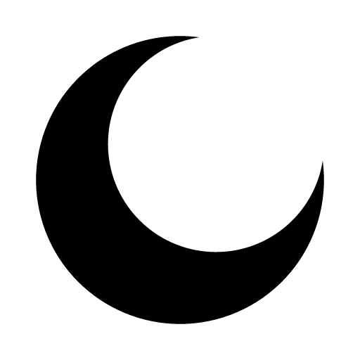 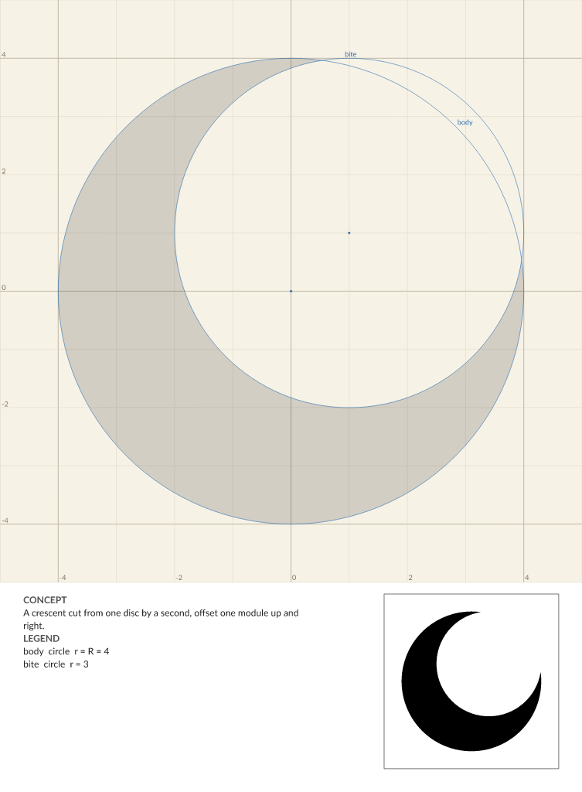</p>

1つの円板を、もう1つの円板で切り取った三日月です。`body` の半径は R（4モジュール）、`bite` は半径 3 で中心を [1, 1] にずらしています。塗りは `body` から `bite` を引いた領域です。

<p>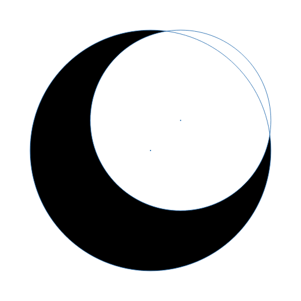</p>

仕様: [`docs/gallery/crescent.json`](docs/gallery/crescent.json)

#### leaf

<p>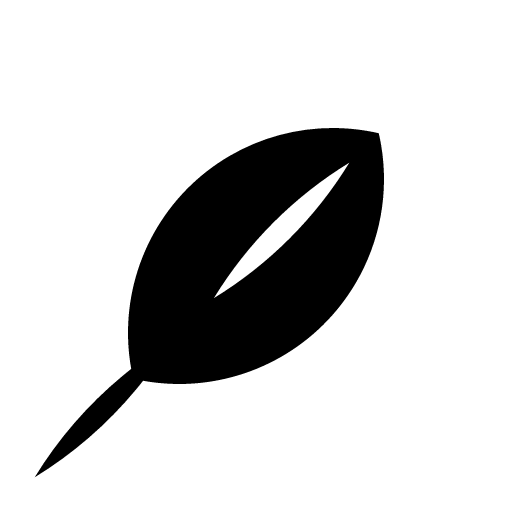 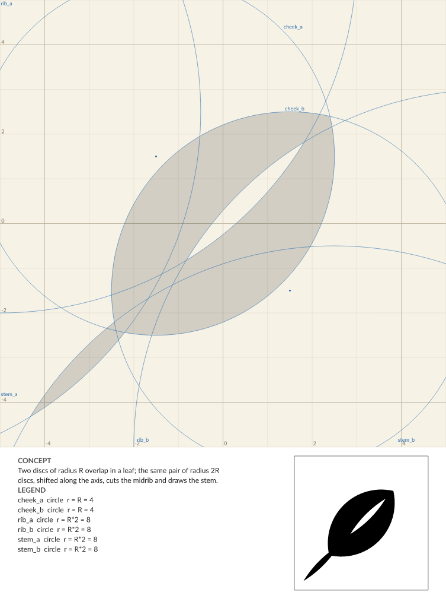</p>

半径 R の2つの円板（中心 [-1.5, 1.5] と [1.5, -1.5]）の重なりがレンズ形になり、これが葉です。同じ軸に沿ってずらした半径 R*2 の円板の組の共通部分を、葉から引いて主脈にしています。もう1組の R*2 の円板の共通部分は茎で、葉と合成しています。使う比は R と R*2 の2つです。

仕様: [`docs/gallery/leaf.json`](docs/gallery/leaf.json)

#### taiji

<p>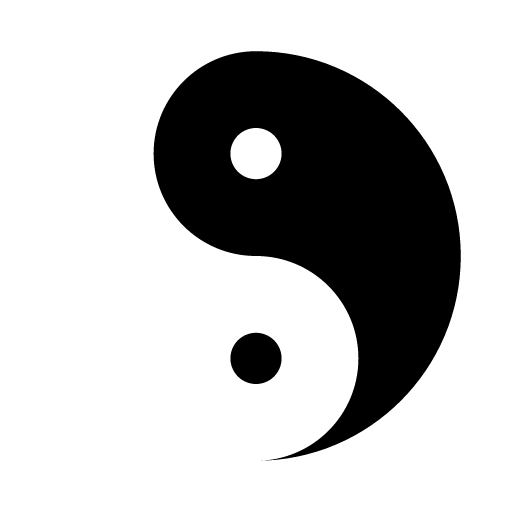 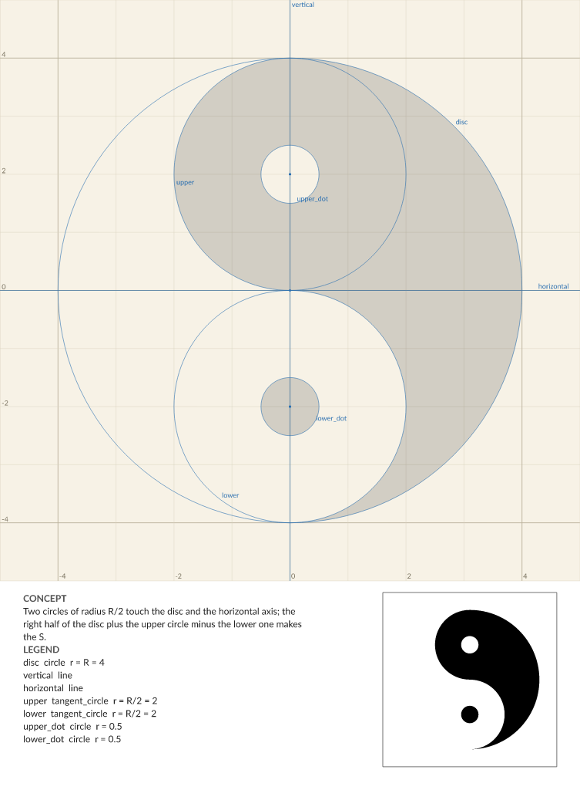</p>

`upper` と `lower` は半径 R/2 の tangent_circle で、どちらも円板と水平線に接し、それぞれ [0, 2] と [0, -2] の近くの解が選ばれます。円板の右半分（垂直線の半平面と円板の共通部分）に `upper` を合成し、`lower` を引くと S 字の境界ができます。上半分には半径 0.5 の点を抜き、下半分には同じ大きさの点を加えています。

<p></p>

仕様: [`docs/gallery/taiji.json`](docs/gallery/taiji.json)

#### open-ring

<p> 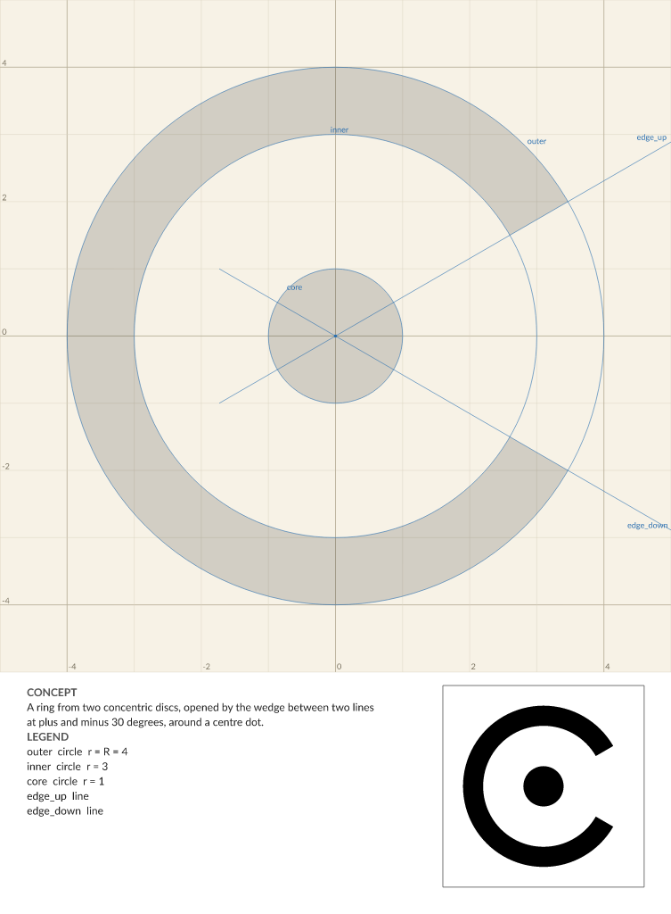</p>

半径 R（4）と 3 の同心円板で輪をつくり、中心に半径 1 の円板を置いています。中心から外周上の +30 度と -30 度の点へ引いた2本の線が楔形を区切ります。この楔は2つの半平面の共通部分で、輪から引くと右側に 60 度の切れ目が開きます。

仕様: [`docs/gallery/open-ring.json`](docs/gallery/open-ring.json)

#### eye

<p>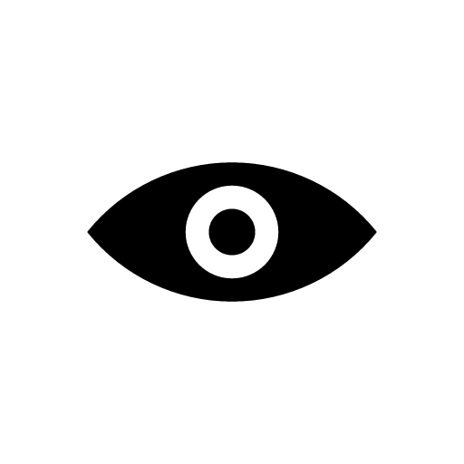 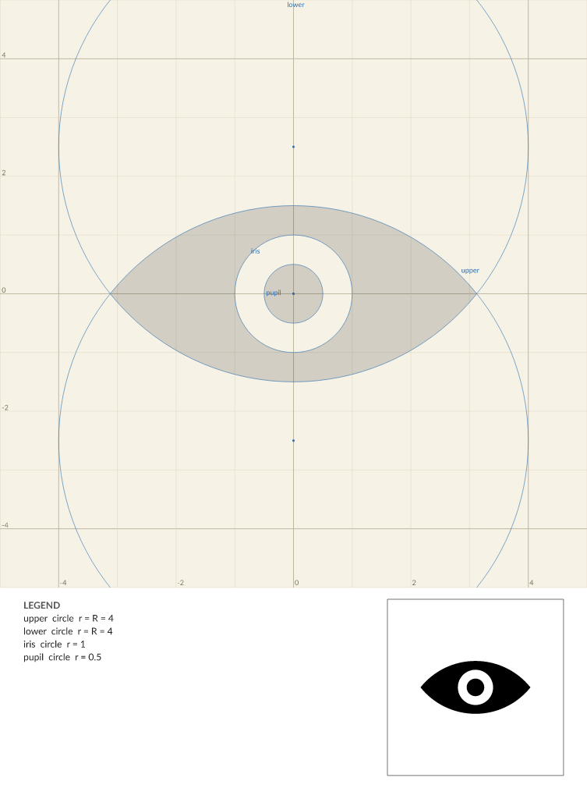</p>

半径 R の2つの円板（中心 [0, -2.5] と [0, 2.5]）の共通部分がレンズ形になります。ここから半径 1 の円板を虹彩として引き、半径 0.5 の円板を瞳として合成しています。

仕様: [`docs/gallery/eye.json`](docs/gallery/eye.json)

#### whale

<p>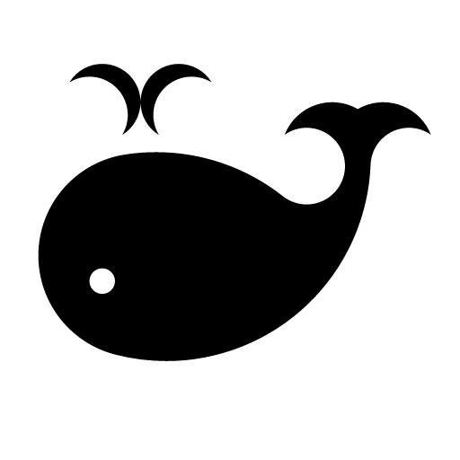 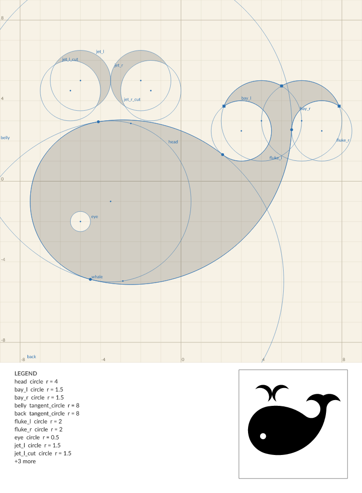</p>

8 分割のグリッド上で、7 個の円を通る1つの `outline` からクジラのシルエットを作っています。`head` は真円で、`belly` と `back` は半径 8 の接円です。それぞれ `head` に内側から、片方の湾に外側から接するため、胴体は角を作らずに尾へ細くなります。`fluke_l` と `fluke_r` は角でつながり、`bay_l` と `bay_r` は `concave` でえぐっています。半径 0.5 の円板を目として引き、潮吹きは円板から円板を引いた 2 つの三日月で作っています。この種の形を絵に合わせるときは、その絵を `underlay` に指定して描画し、`match` を読みます。

<p>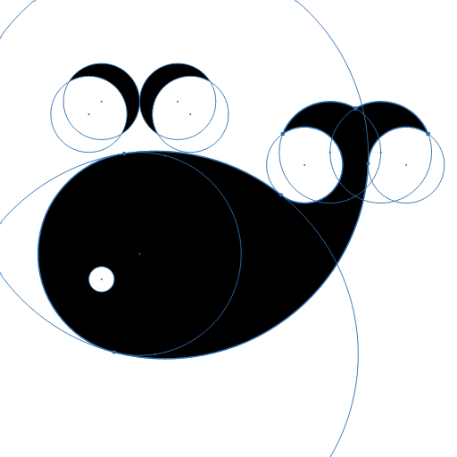</p>

仕様: [`docs/gallery/whale.json`](docs/gallery/whale.json)

### figure

#### hexagram-circle

<p> 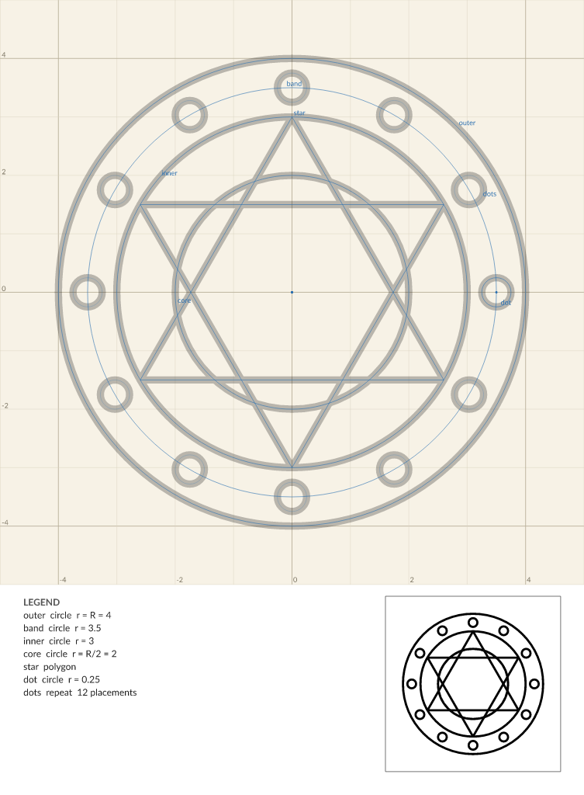</p>

半径 R、3、R/2 の円を描き、半径 3.5 の補助円は描きません。六芒星は半径 3 の円に内接する多角形 {6/2}（`n: 6`、`step: 2`）です。補助円上の角度 0 に半径 0.25 の小円を置き、30 度ずつ 12 回繰り返しています。

仕様: [`docs/gallery/hexagram-circle.json`](docs/gallery/hexagram-circle.json)

#### pentagram

<p>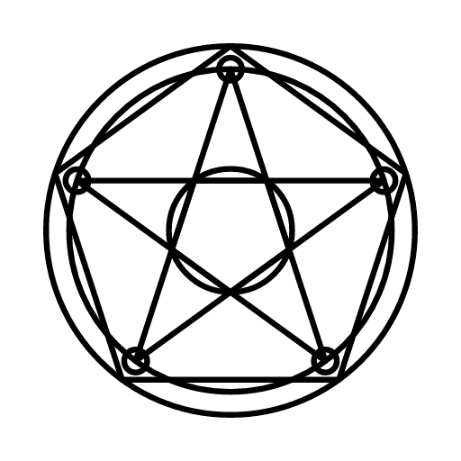 </p>

五芒星は半径 3.5 の `ring` に内接する {5/2} です。`core` の半径は `ring.r/phi2`（ring の半径を黄金比の2乗で割った値）で、上下を反転させた五角形が内接します。外円に内接する五角形が全体を囲み、星の頂点にあたる ring 上の5か所に小円を繰り返しています。

<p>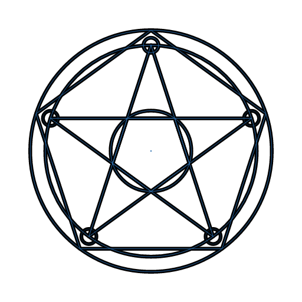</p>

仕様: [`docs/gallery/pentagram.json`](docs/gallery/pentagram.json)

#### sigil-medallions

<p>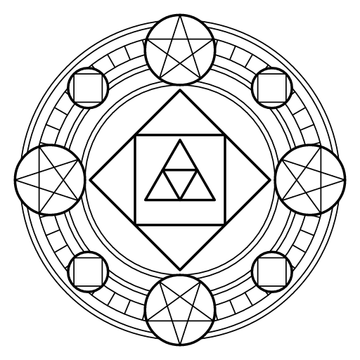 </p>

グリッドの分割数は 8 なので R は 8 です。二重線の同心円帯（a1/a2、c1/c2、d1/d2）の間に放射状の目盛りの輪があり、24本の目盛りを 7.5 度ずらして2組繰り返しています。内側には、`sq_a` に内接する正方形と、`sq_b`（`sq_a.r/sqrt2`）に内接して 45 度回した正方形、それに `tri_a` と `tri_a.r/2` の `tri_b` に内接する2つの三角形があります。8つのメダリオン（半径 1.75 のものと半径 1 のものを 90 度ごとに4個ずつ）は erase レイヤーで背後の帯を消し、その上に描き直して、中に星か正方形を入れています。使う比は 1/sqrt2 と 1/2 の2つです。

<p>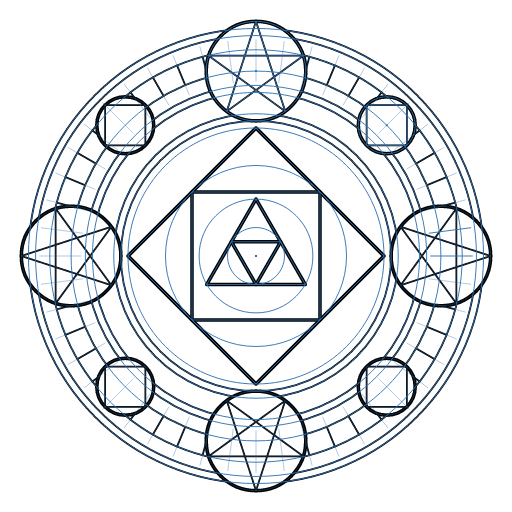</p>

仕様: [`docs/gallery/sigil-medallions.json`](docs/gallery/sigil-medallions.json)

#### crescent-moon

<p>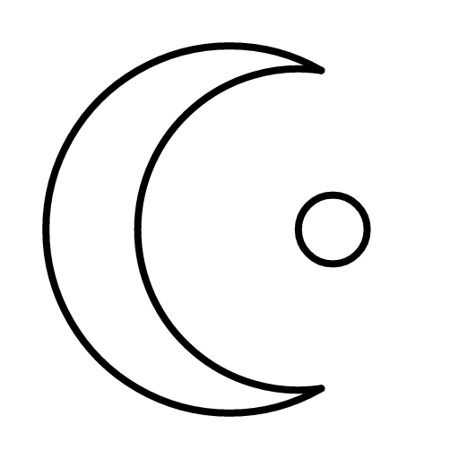 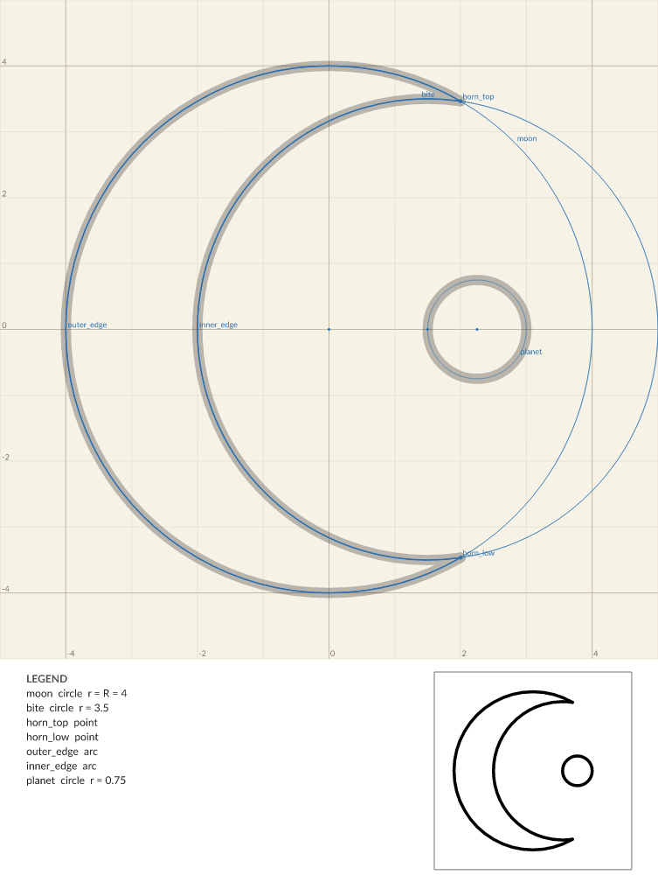</p>

月（半径 R）と第2の円 `bite`（半径 3.5、中心 [1.5, 0]）は2点で交わり、その交点が `horn_top` と `horn_low` です。輪郭は2点の間の2本の円弧で、月上の `outer_edge` と `bite` 上の `inner_edge` が、どちらも `horn_top` から `horn_low` へ反時計回りに進みます。三日月の脇には小さな円を描いています。

仕様: [`docs/gallery/crescent-moon.json`](docs/gallery/crescent-moon.json)

#### petal-rosette

<p>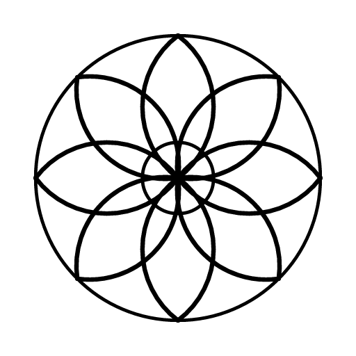 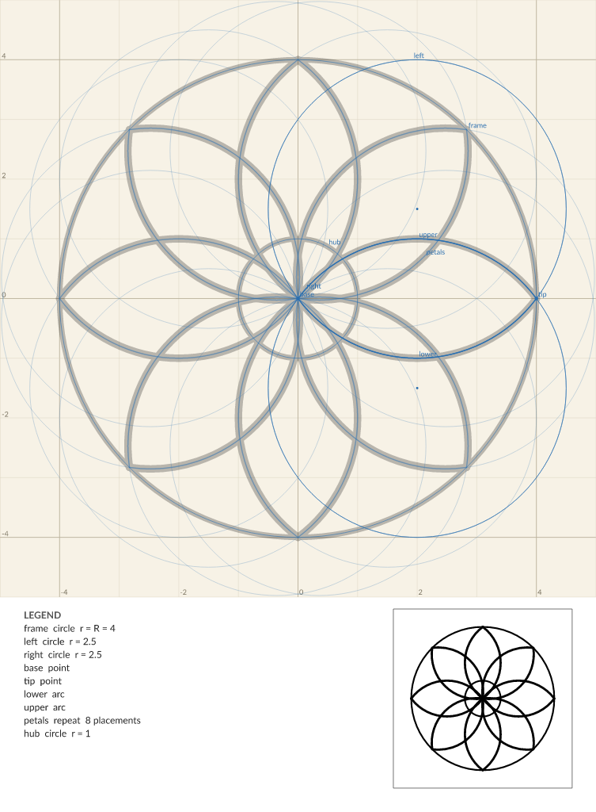</p>

半径 2.5 の2つの円（中心 [2, 1.5] と [2, -1.5]）が、原点付近の `base` と [4, 0] 付近の `tip` で交わります。花びら1枚は、この2点の間で各円から取った2本の円弧です。これを中心まわりに8回繰り返し、中心の円と外枠の円は別の線幅で描いています。

<p>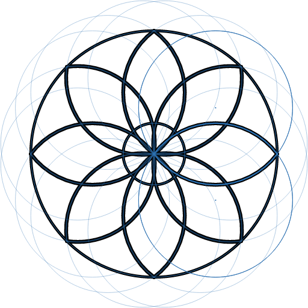</p>

仕様: [`docs/gallery/petal-rosette.json`](docs/gallery/petal-rosette.json)

#### hexagon-rosette

<p>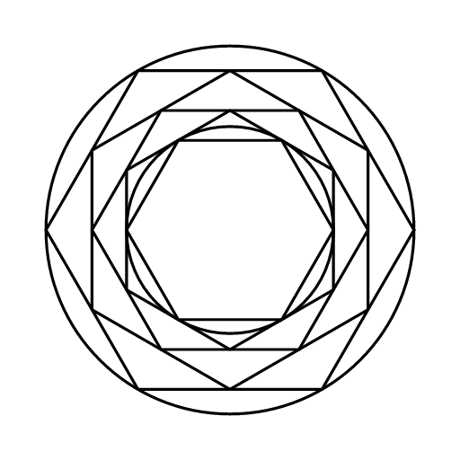 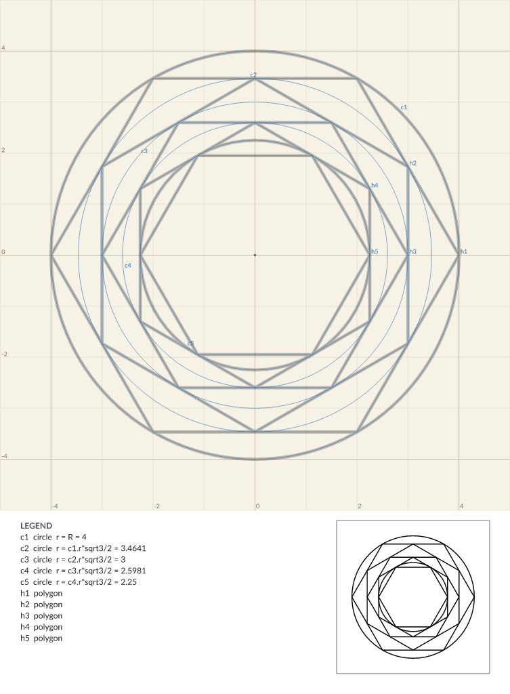</p>

各円は前の円に `sqrt3/2`（正六角形の辺心距離の比）を掛けた半径です。そのため、円に内接する六角形の辺の中点は次に小さい円に接します。六角形は1つおきに 30 度回しています。図全体で使う比は1つだけです。

仕様: [`docs/gallery/hexagon-rosette.json`](docs/gallery/hexagon-rosette.json)

## 含まないもの（Non-goals）

gridsmith が扱うのは幾何だけです。文字は描画しません。完成図に文字は含まれません。
