# Gallery

Each example is a complete spec that passes every rule. For each, the finished drawing is on the left and the construction sheet (grid, construction circles and lines, legend) on the right. The files are under `../gallery/`, including SVGs.

## mark

### crescent

 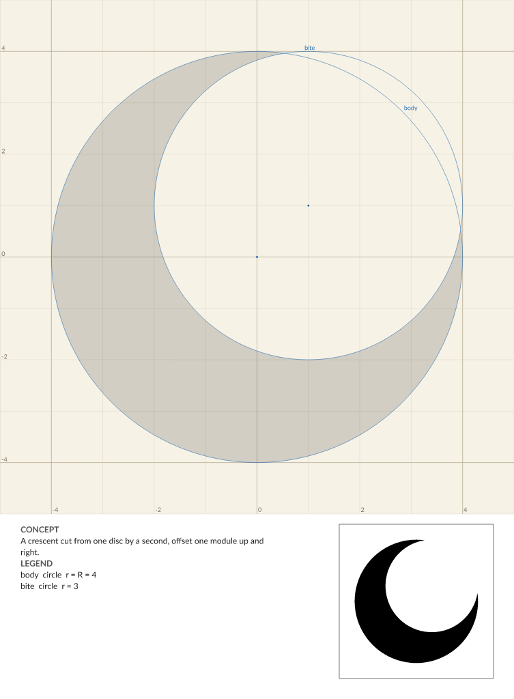

A crescent cut from one disc by a second disc. `body` has radius R (4 modules); `bite` has radius 3 and its centre is offset to [1, 1]. The fill is `body` minus `bite`.

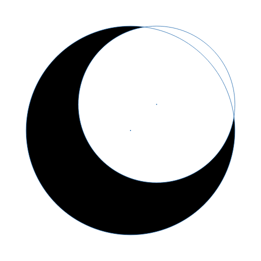

Spec: [`../gallery/crescent.json`](../gallery/crescent.json)

### leaf

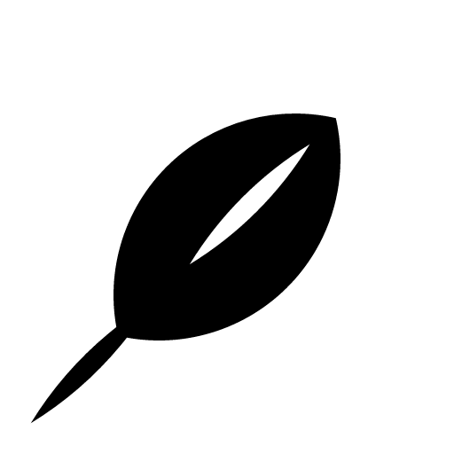 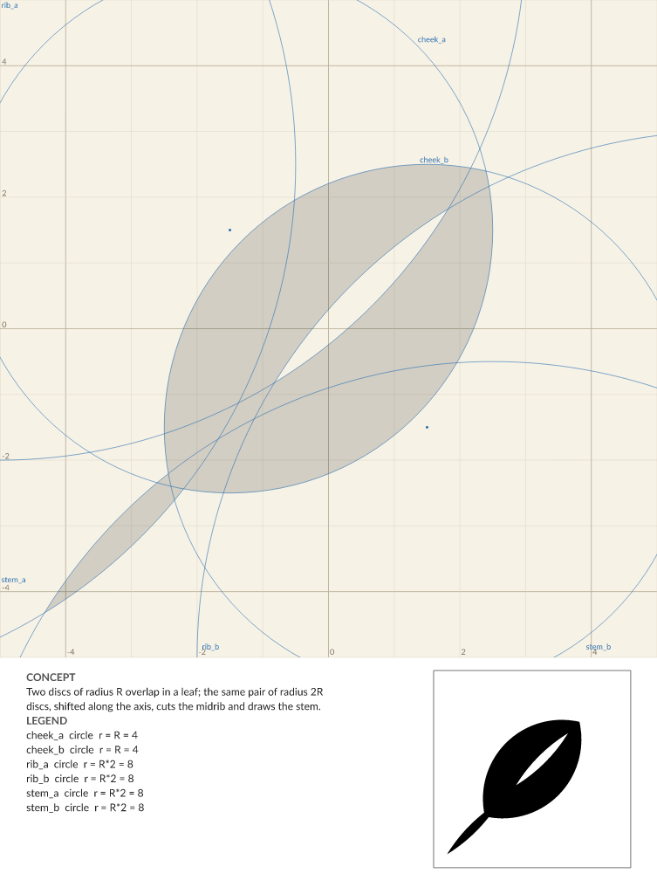

Two discs of radius R centred at [-1.5, 1.5] and [1.5, -1.5] overlap in a lens, which is the leaf. A second pair of discs of radius R*2 (shifted along the same axis) is intersected and subtracted from the lens as the midrib. A third pair of R*2 discs, intersected, forms the stem and is united with the leaf. The spec uses two ratios, R and R*2.

Spec: [`../gallery/leaf.json`](../gallery/leaf.json)

### taiji

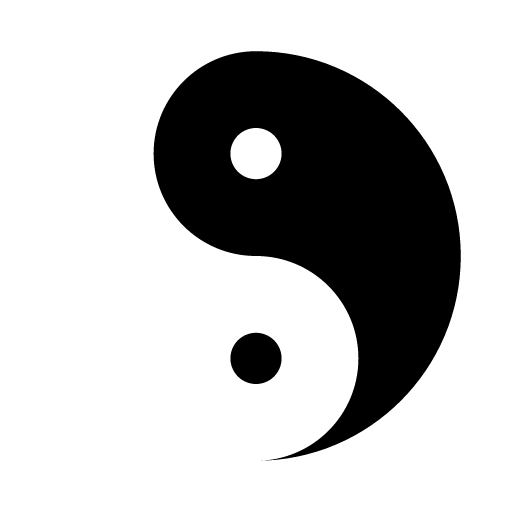 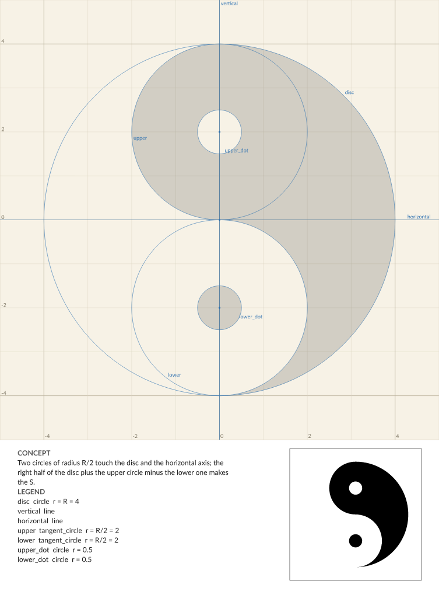

`upper` and `lower` are tangent_circles of radius R/2, each touching the disc and the horizontal line, found near [0, 2] and [0, -2]. The right half of the disc (a half-plane through the vertical line, intersected with the disc) is united with `upper` and has `lower` subtracted, which draws the S-curve. A dot of radius 0.5 is cut out of the upper half and added back in the lower half.

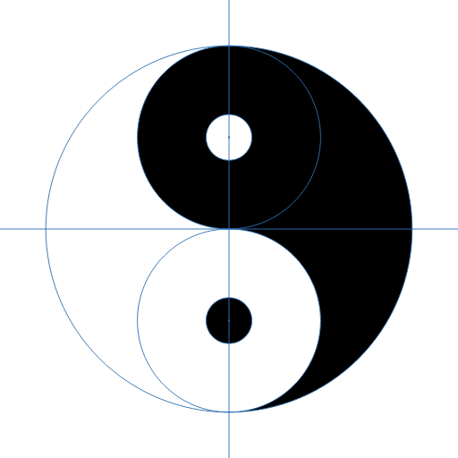

Spec: [`../gallery/taiji.json`](../gallery/taiji.json)

### open-ring

 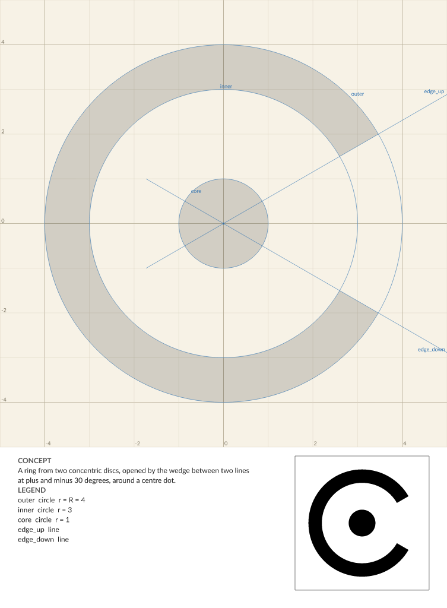

Concentric discs of radius R (4) and 3 make a ring, and a core disc of radius 1 sits at the centre. Two lines from the centre to the outer circle at +30 and -30 degrees bound a wedge, built as the intersection of two half-planes, and it is subtracted from the ring to open a 60 degree gap on the right.

Spec: [`../gallery/open-ring.json`](../gallery/open-ring.json)

### eye

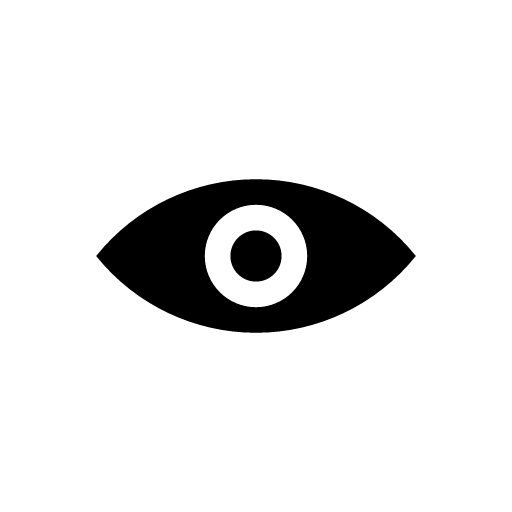 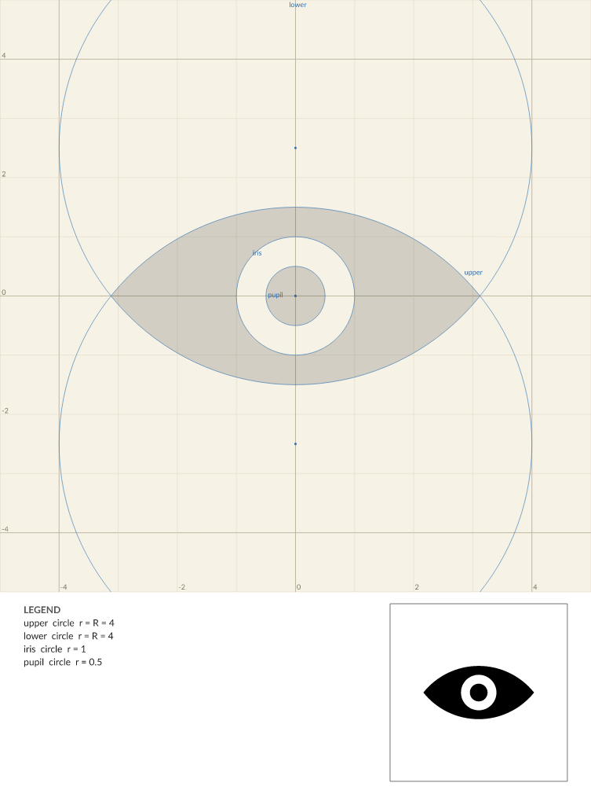

Two discs of radius R centred at [0, -2.5] and [0, 2.5] intersect in a lens. A disc of radius 1 is subtracted from it as the iris, and a disc of radius 0.5 is united back as the pupil.

Spec: [`../gallery/eye.json`](../gallery/eye.json)

### whale

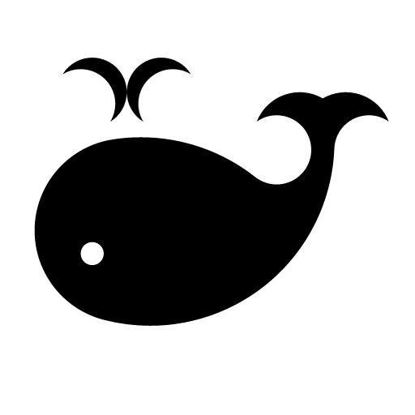 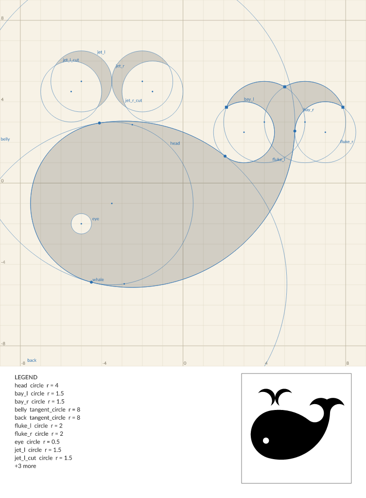

A whale silhouette from a single `outline` through seven circles on an 8-division grid. `head` is a round circle; `belly` and `back` are tangent circles of radius 8 that each touch the head from inside and one bay from outside, so the body tapers to the tail without a corner. `fluke_l` and `fluke_r` meet at corners, and `bay_l` and `bay_r` are carved in (`concave`). A disc of radius 0.5 is subtracted as the eye, and the spout is two crescents, each a disc minus a disc. To fit a shape like this to a picture, render it with `underlay` set to the picture and read `match`.

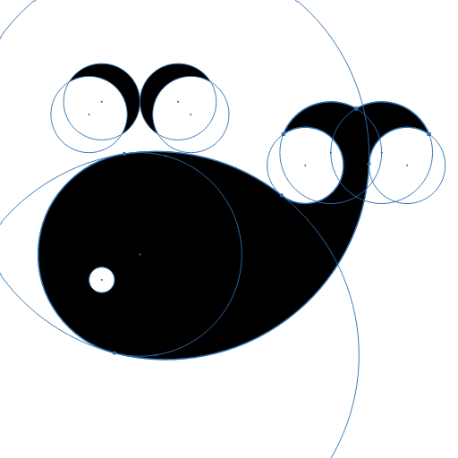

Spec: [`../gallery/whale.json`](../gallery/whale.json)

## icon

### line-chart

 

A rounded `rect` plate (radius 3) is filled, then two stroke layers are drawn over it: the axes, a `polyline` with mitred joins and butt caps, and a rising zigzag through four `point` elements spaced 4 modules apart in x. The dot at the end is a filled circle of radius 1.5 centred on the last point, so the polyline and the dot share it by id.

 

Spec: [`../gallery/line-chart.json`](../gallery/line-chart.json)

## figure

### hexagram-circle

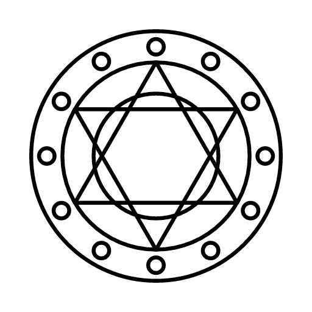 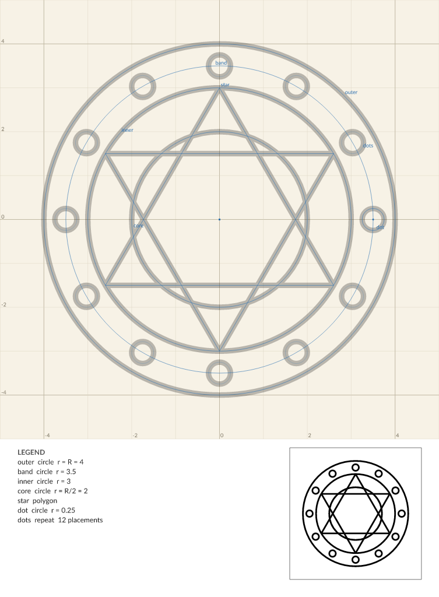

Circles of radius R, 3, and R/2 are stroked, with a helper circle of radius 3.5 that is not stroked. A hexagram is the polygon {6/2} (`n: 6`, `step: 2`) inscribed in the radius 3 circle. A small circle of radius 0.25 sits on the helper circle at angle 0 and is repeated 12 times, 30 degrees apart.

Spec: [`../gallery/hexagram-circle.json`](../gallery/hexagram-circle.json)

### pentagram

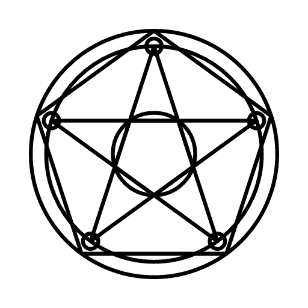 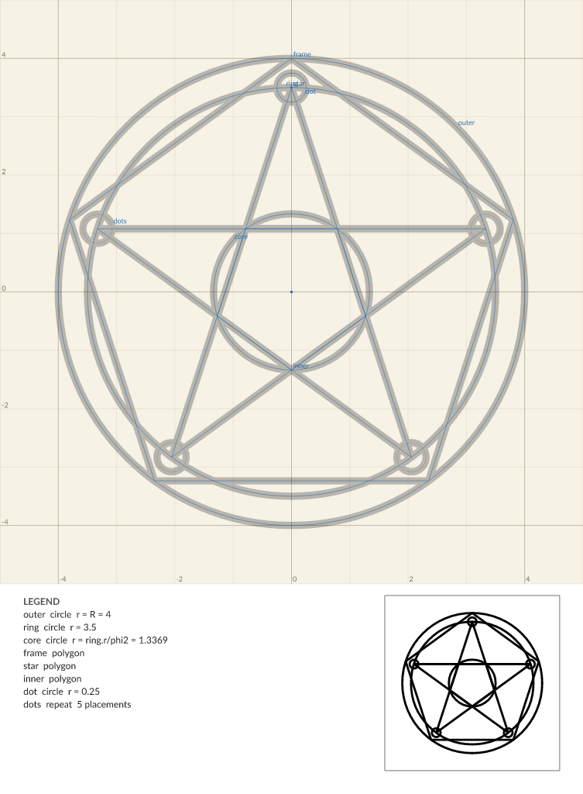

The pentagram is {5/2} inscribed in the radius 3.5 `ring`. `core` has radius `ring.r/phi2`, which is the ring radius divided by the golden ratio squared, and holds a pentagon turned upside down. A pentagon inscribed in the outer circle frames the figure, and five small circles repeat around the ring at the star points.

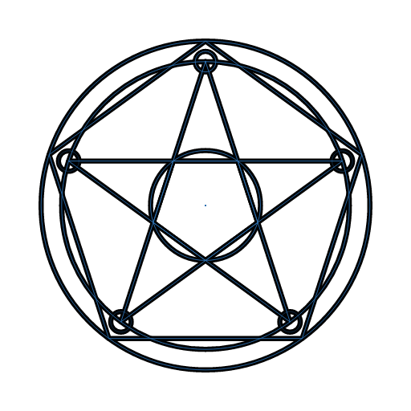

Spec: [`../gallery/pentagram.json`](../gallery/pentagram.json)

### sigil-medallions

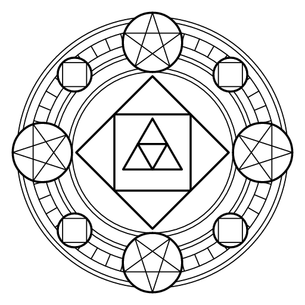 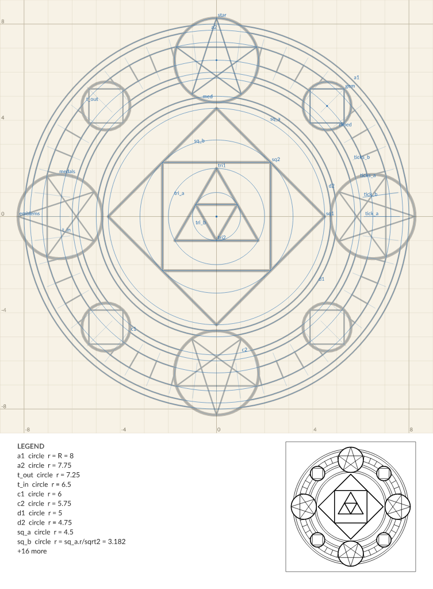

The grid has 8 divisions, so R is 8. Concentric double-line bands (a1/a2, c1/c2, d1/d2) surround a ring of radial ticks, drawn as two repeats of 24 ticks offset by 7.5 degrees. Inside are two squares, one inscribed in `sq_a` and one in `sq_b` (`sq_a.r/sqrt2`) turned 45 degrees, and two triangles, with `tri_b` at `tri_a.r/2`. Eight medallions (four of radius 1.75 and four of radius 1, repeated every 90 degrees) are an erase layer that hides the bands behind them; they are stroked again on top and each holds a star or a square. The spec uses two ratios, 1/sqrt2 and 1/2.

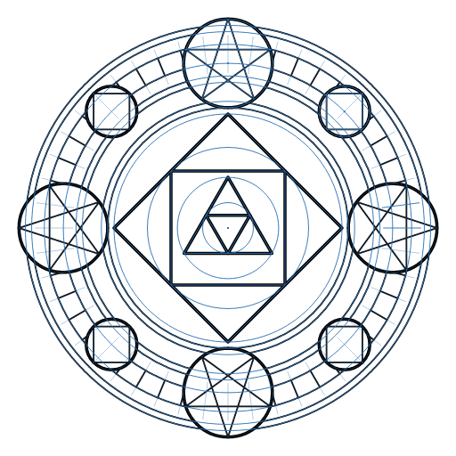

Spec: [`../gallery/sigil-medallions.json`](../gallery/sigil-medallions.json)

### crescent-moon

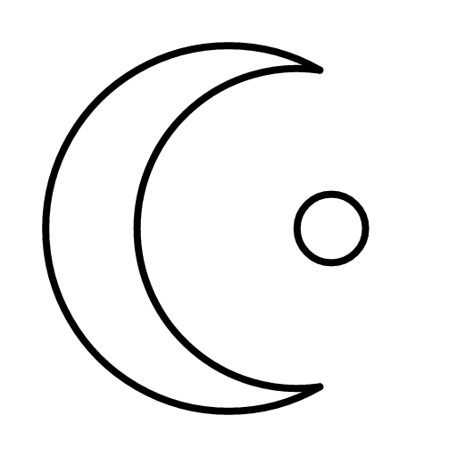 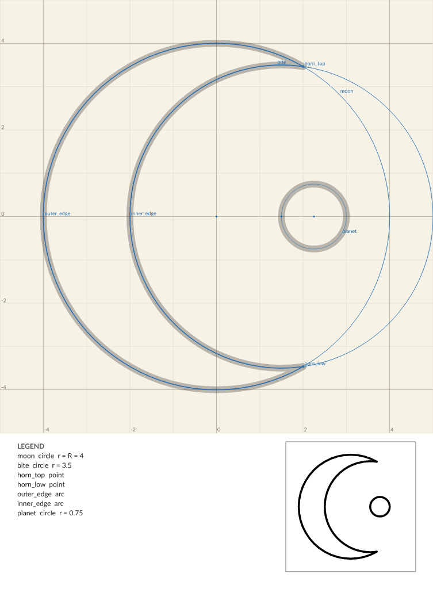

The moon (radius R) and a second circle `bite` (radius 3.5, centre [1.5, 0]) intersect in two points, `horn_top` and `horn_low`. The outline is two arcs between them, `outer_edge` on the moon and `inner_edge` on `bite`, each running counter-clockwise from `horn_top` to `horn_low`. A small circle is drawn beside the crescent.

Spec: [`../gallery/crescent-moon.json`](../gallery/crescent-moon.json)

### petal-rosette

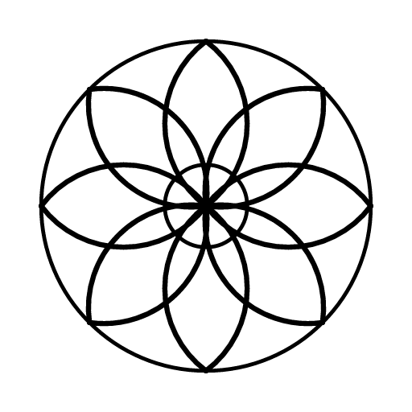 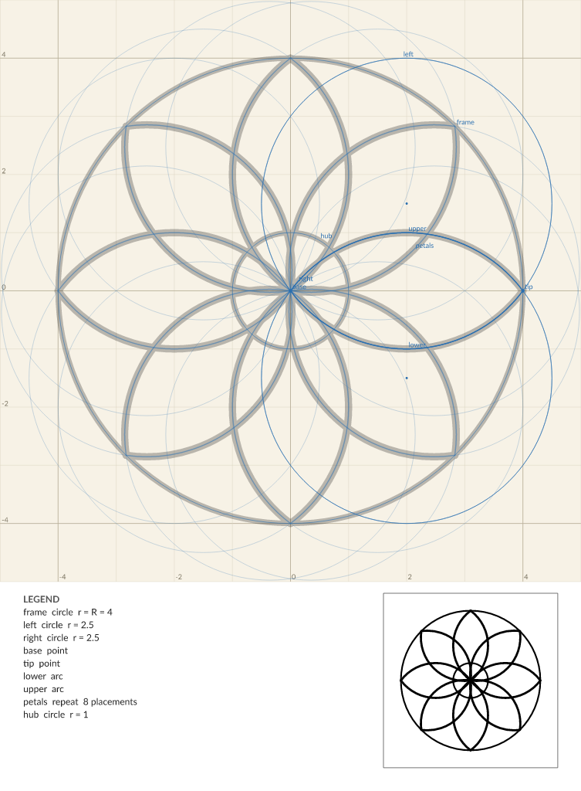

Two circles of radius 2.5 centred at [2, 1.5] and [2, -1.5] intersect at `base` (near the origin) and `tip` (near [4, 0]). One petal is two arcs between those points, one on each circle. The petal is repeated 8 times about the centre, and a hub circle and the frame circle are stroked at different widths.

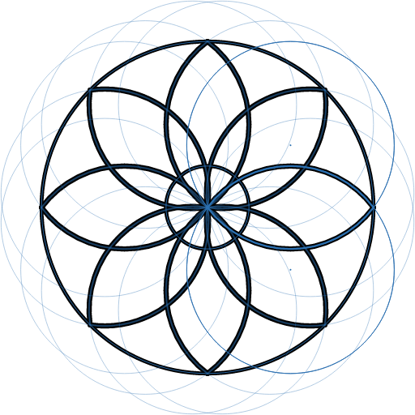

Spec: [`../gallery/petal-rosette.json`](../gallery/petal-rosette.json)

### hexagon-rosette

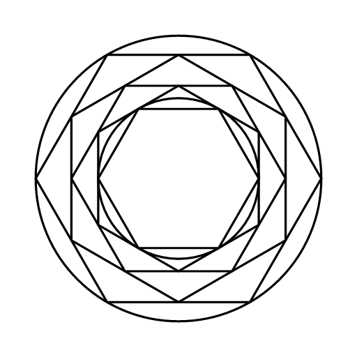 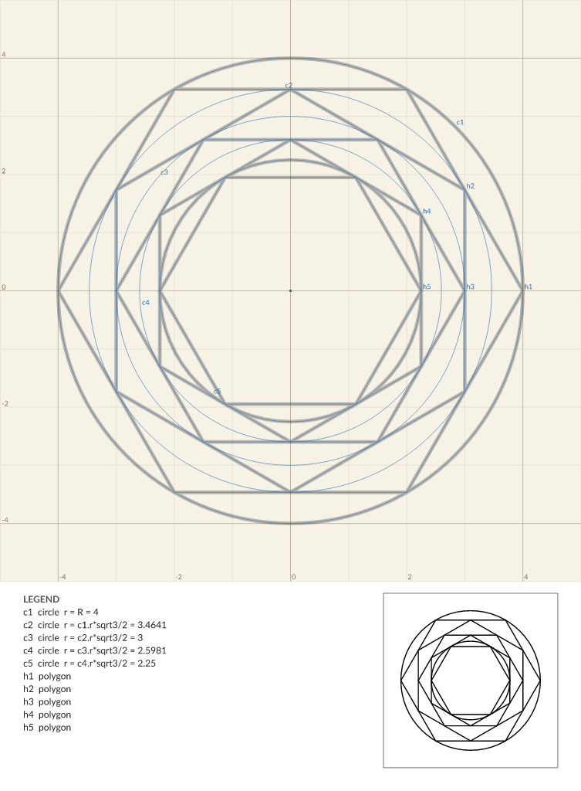

Each circle is the previous one scaled by `sqrt3/2`, the apothem ratio of a hexagon, so every hexagon inscribed in a circle has its edge midpoints on the next smaller circle. Alternate hexagons are turned 30 degrees. The whole figure uses a single ratio.

Spec: [`../gallery/hexagon-rosette.json`](../gallery/hexagon-rosette.json)
