# ギャラリー

どの例も、すべての規則を通る完全な仕様です。左が完成図、右が構築シート（グリッド、構築用の円と線、凡例）で、SVG も含めたファイルは `../gallery/` にあります。

## mark

### crescent

 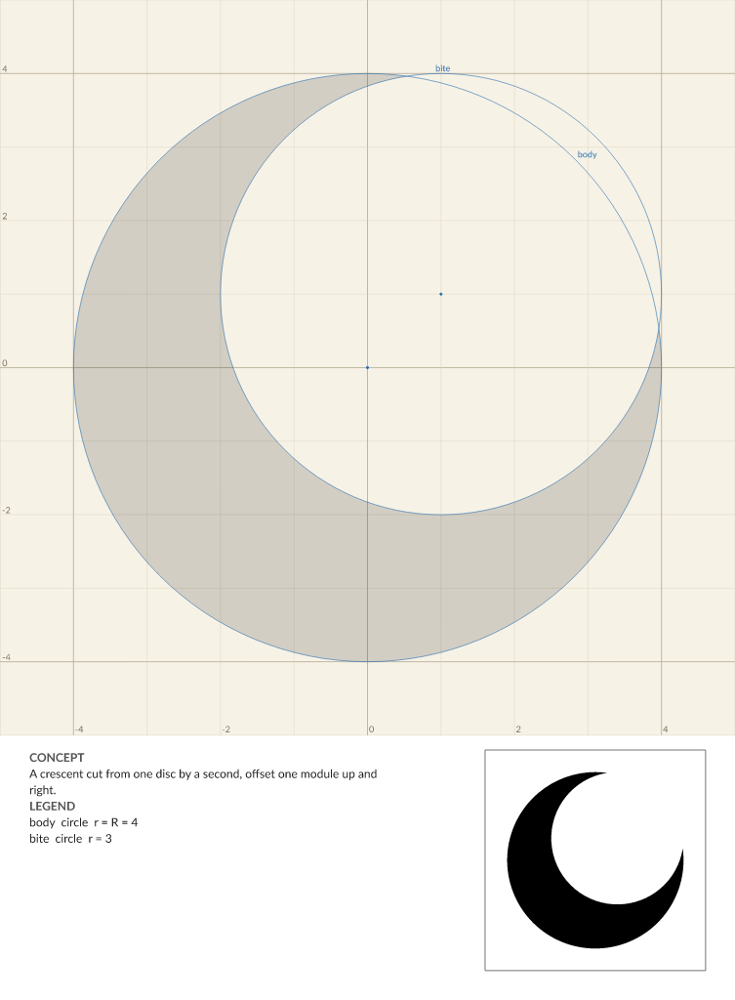

1つの円板を、もう1つの円板で切り取った三日月です。`body` の半径は R（4モジュール）、`bite` は半径 3 で中心を [1, 1] にずらしています。塗りは `body` から `bite` を引いた領域です。

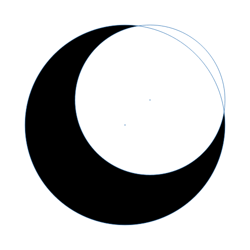

仕様: [`../gallery/crescent.json`](../gallery/crescent.json)

### leaf

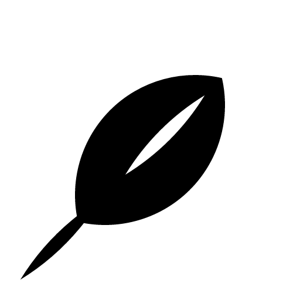 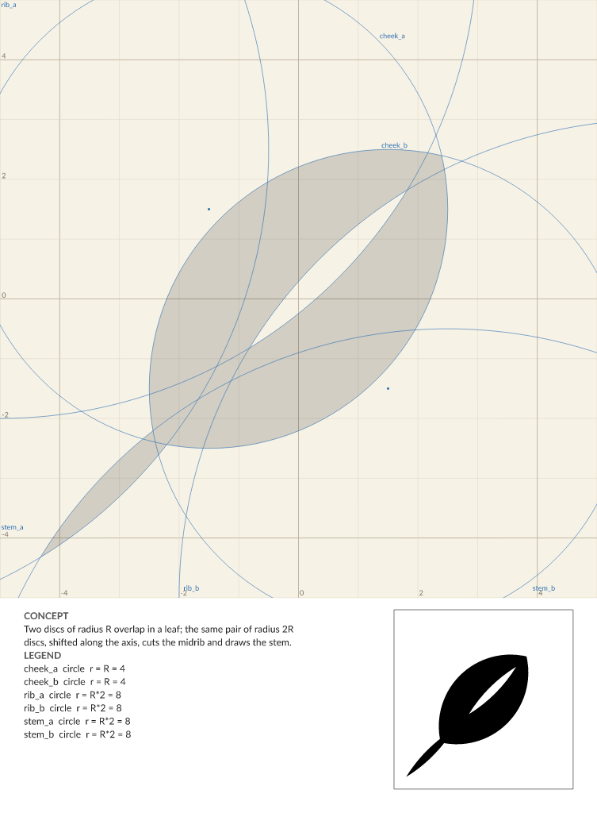

半径 R の2つの円板（中心 [-1.5, 1.5] と [1.5, -1.5]）の重なりがレンズ形になり、これが葉です。同じ軸に沿ってずらした半径 R*2 の円板の組の共通部分を、葉から引いて主脈にしています。もう1組の R*2 の円板の共通部分は茎で、葉と合成しています。使う比は R と R*2 の2つです。

仕様: [`../gallery/leaf.json`](../gallery/leaf.json)

### taiji

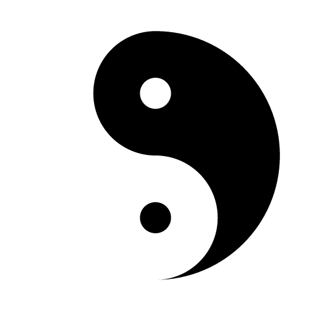 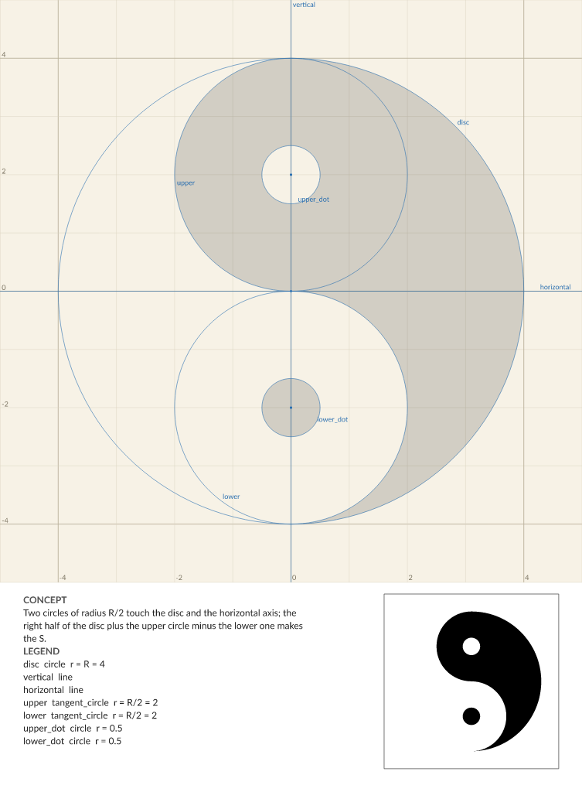

`upper` と `lower` は半径 R/2 の tangent_circle で、どちらも円板と水平線に接し、それぞれ [0, 2] と [0, -2] の近くの解が選ばれます。円板の右半分（垂直線の半平面と円板の共通部分）に `upper` を合成し、`lower` を引くと S 字の境界ができます。上半分には半径 0.5 の点を抜き、下半分には同じ大きさの点を加えています。

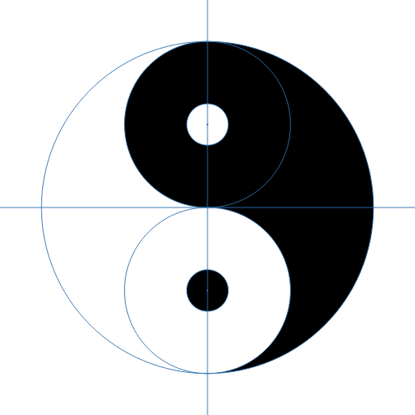

仕様: [`../gallery/taiji.json`](../gallery/taiji.json)

### open-ring

 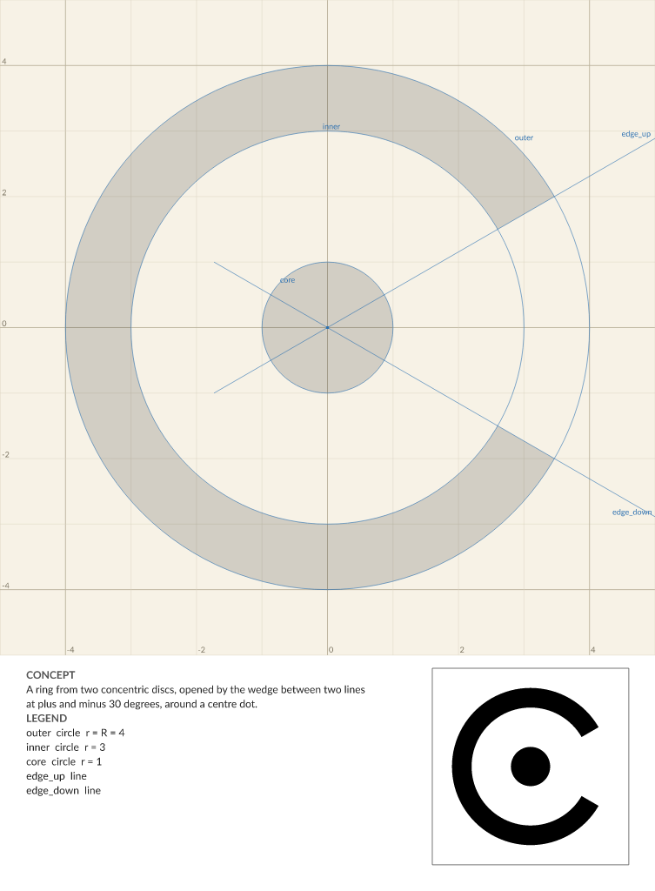

半径 R（4）と 3 の同心円板で輪をつくり、中心に半径 1 の円板を置いています。中心から外周上の +30 度と -30 度の点へ引いた2本の線が楔形を区切ります。この楔は2つの半平面の共通部分で、輪から引くと右側に 60 度の切れ目が開きます。

仕様: [`../gallery/open-ring.json`](../gallery/open-ring.json)

### eye

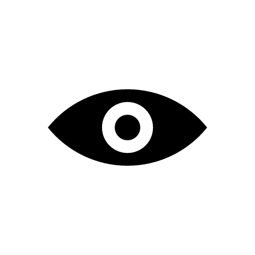 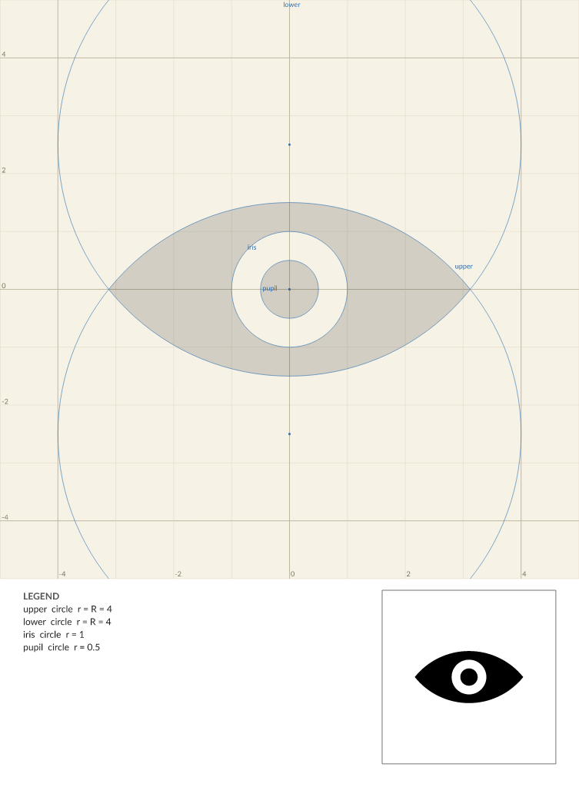

半径 R の2つの円板（中心 [0, -2.5] と [0, 2.5]）の共通部分がレンズ形になります。ここから半径 1 の円板を虹彩として引き、半径 0.5 の円板を瞳として合成しています。

仕様: [`../gallery/eye.json`](../gallery/eye.json)

### whale

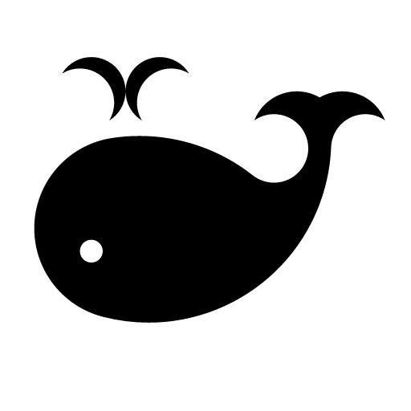 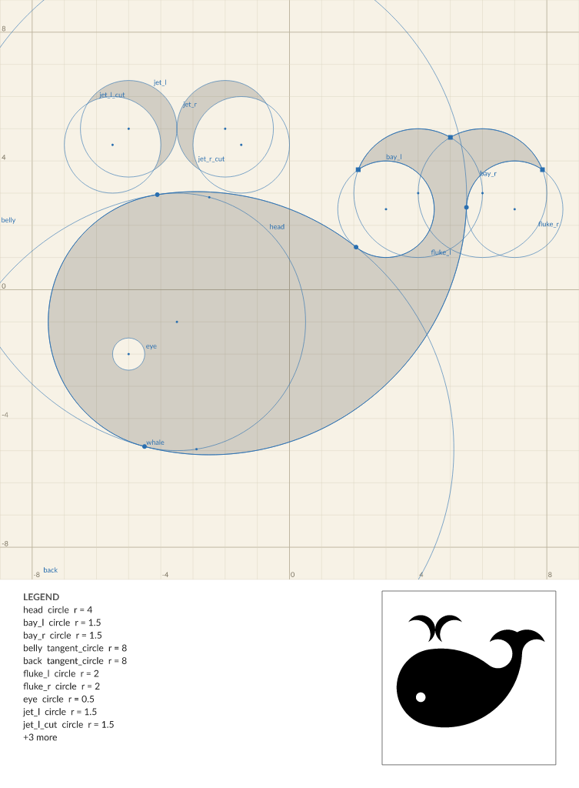

8 分割のグリッド上で、7 個の円を通る1つの `outline` からクジラのシルエットを作っています。`head` は真円で、`belly` と `back` は半径 8 の接円です。それぞれ `head` に内側から、片方の湾に外側から接するため、胴体は角を作らずに尾へ細くなります。`fluke_l` と `fluke_r` は角でつながり、`bay_l` と `bay_r` は `concave` でえぐっています。半径 0.5 の円板を目として引き、潮吹きは円板から円板を引いた 2 つの三日月で作っています。この種の形を絵に合わせるときは、その絵を `underlay` に指定して描画し、`match` を読みます。

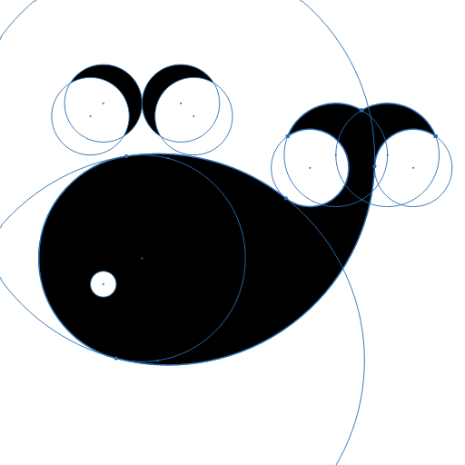

仕様: [`../gallery/whale.json`](../gallery/whale.json)

## icon

### line-chart

 

角丸（半径 3）の `rect` の板を塗り、その上に 2 つの線レイヤーを重ねています。1 つは軸で、角を miter、線端を butt にした `polyline` です。もう 1 つは、x が 4 モジュールずつ離れた 4 つの `point` を通る右上がりの折れ線です。端の点は、最後の点を中心にした半径 1.5 の塗りの円で、折れ線と点が id で同じ点を共有しています。

 

仕様: [`../gallery/line-chart.json`](../gallery/line-chart.json)

## figure

### hexagram-circle

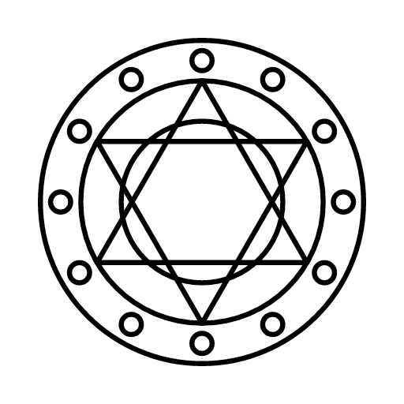 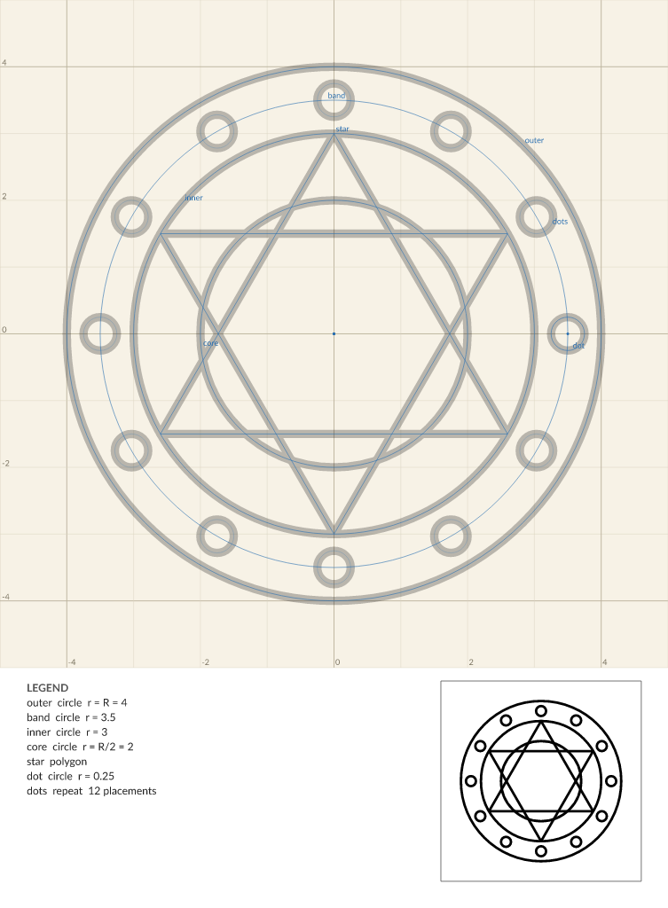

半径 R、3、R/2 の円を描き、半径 3.5 の補助円は描きません。六芒星は半径 3 の円に内接する多角形 {6/2}（`n: 6`、`step: 2`）です。補助円上の角度 0 に半径 0.25 の小円を置き、30 度ずつ 12 回繰り返しています。

仕様: [`../gallery/hexagram-circle.json`](../gallery/hexagram-circle.json)

### pentagram

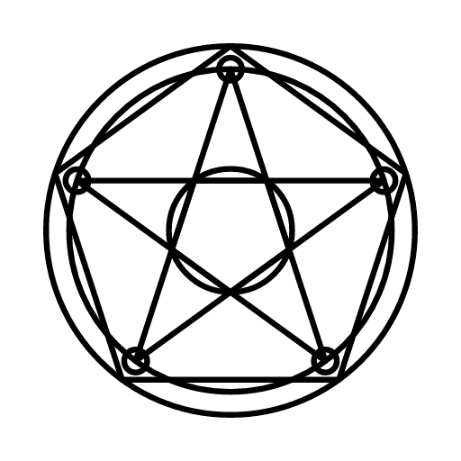 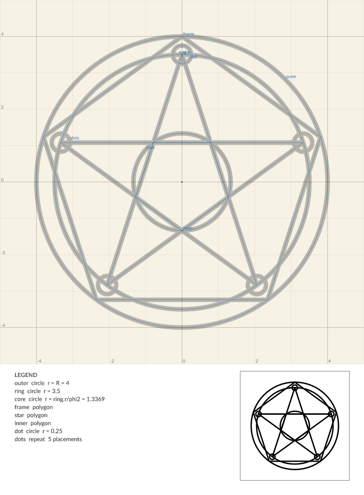

五芒星は半径 3.5 の `ring` に内接する {5/2} です。`core` の半径は `ring.r/phi2`（ring の半径を黄金比の2乗で割った値）で、上下を反転させた五角形が内接します。外円に内接する五角形が全体を囲み、星の頂点にあたる ring 上の5か所に小円を繰り返しています。

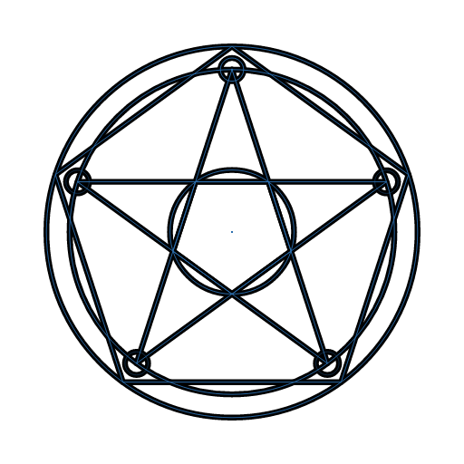

仕様: [`../gallery/pentagram.json`](../gallery/pentagram.json)

### sigil-medallions

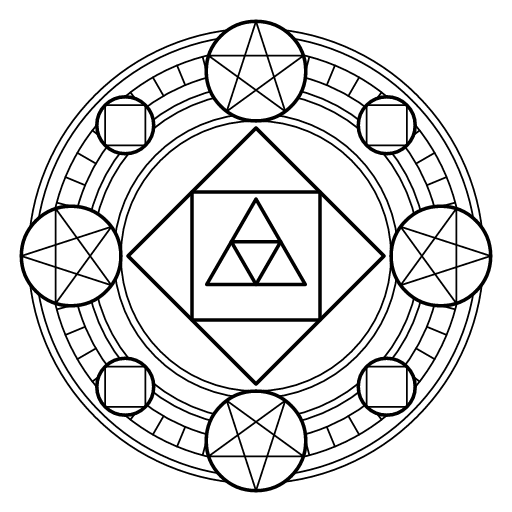 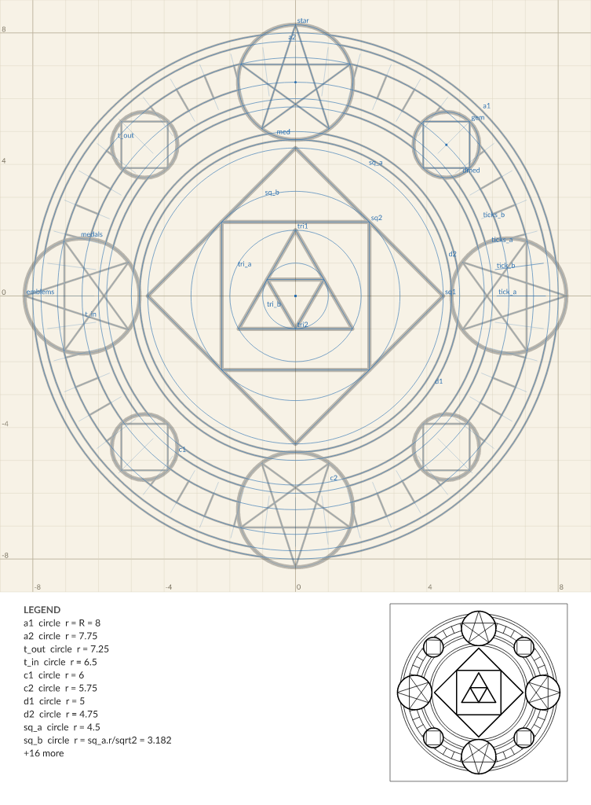

グリッドの分割数は 8 なので R は 8 です。二重線の同心円帯（a1/a2、c1/c2、d1/d2）の間に放射状の目盛りの輪があり、24本の目盛りを 7.5 度ずらして2組繰り返しています。内側には、`sq_a` に内接する正方形と、`sq_b`（`sq_a.r/sqrt2`）に内接して 45 度回した正方形、それに `tri_a` と `tri_a.r/2` の `tri_b` に内接する2つの三角形があります。8つのメダリオン（半径 1.75 のものと半径 1 のものを 90 度ごとに4個ずつ）は erase レイヤーで背後の帯を消し、その上に描き直して、中に星か正方形を入れています。使う比は 1/sqrt2 と 1/2 の2つです。

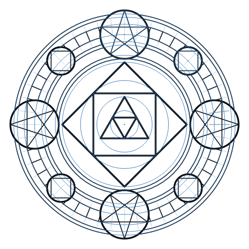

仕様: [`../gallery/sigil-medallions.json`](../gallery/sigil-medallions.json)

### crescent-moon

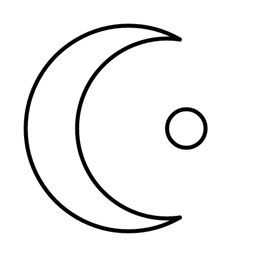 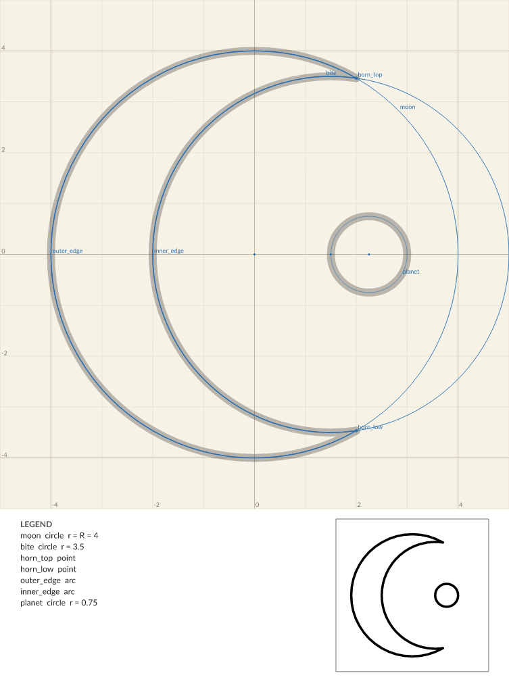

月（半径 R）と第2の円 `bite`（半径 3.5、中心 [1.5, 0]）は2点で交わり、その交点が `horn_top` と `horn_low` です。輪郭は2点の間の2本の円弧で、月上の `outer_edge` と `bite` 上の `inner_edge` が、どちらも `horn_top` から `horn_low` へ反時計回りに進みます。三日月の脇には小さな円を描いています。

仕様: [`../gallery/crescent-moon.json`](../gallery/crescent-moon.json)

### petal-rosette

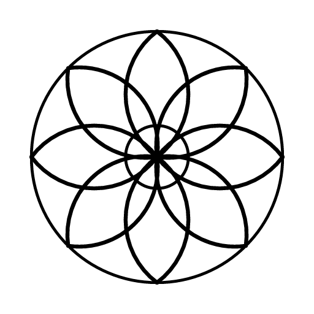 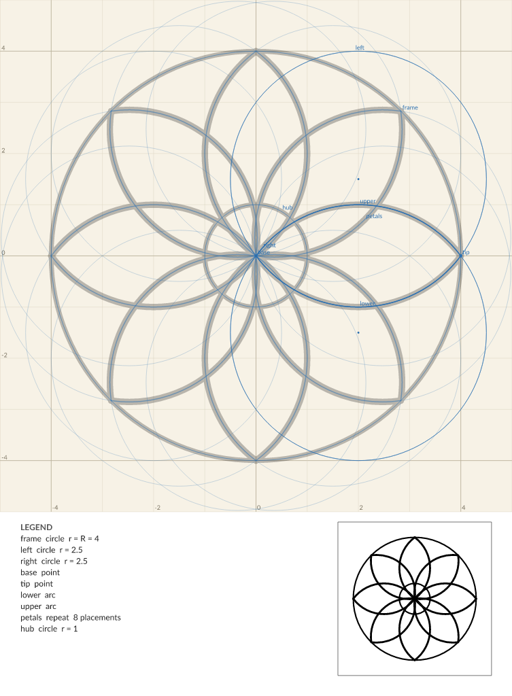

半径 2.5 の2つの円（中心 [2, 1.5] と [2, -1.5]）が、原点付近の `base` と [4, 0] 付近の `tip` で交わります。花びら1枚は、この2点の間で各円から取った2本の円弧です。これを中心まわりに8回繰り返し、中心の円と外枠の円は別の線幅で描いています。

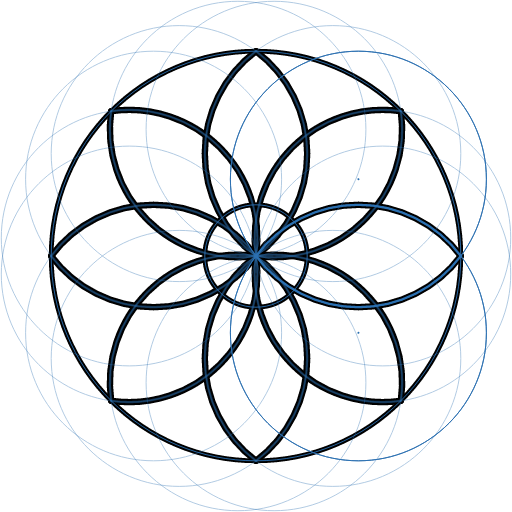

仕様: [`../gallery/petal-rosette.json`](../gallery/petal-rosette.json)

### hexagon-rosette

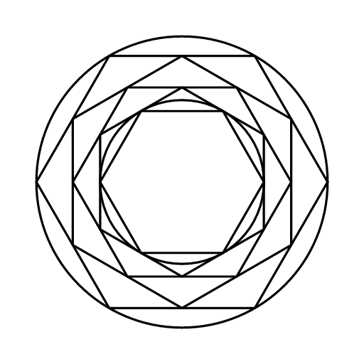 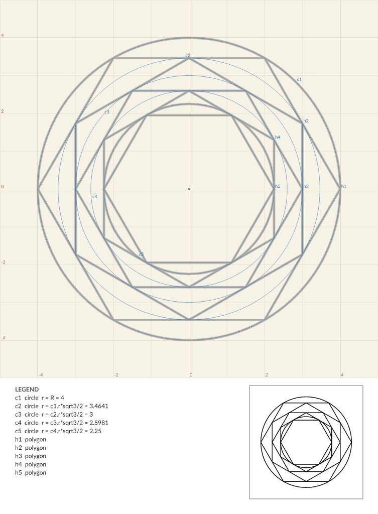

各円は前の円に `sqrt3/2`（正六角形の辺心距離の比）を掛けた半径です。そのため、円に内接する六角形の辺の中点は次に小さい円に接します。六角形は1つおきに 30 度回しています。図全体で使う比は1つだけです。

仕様: [`../gallery/hexagon-rosette.json`](../gallery/hexagon-rosette.json)
