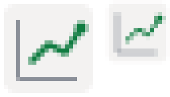

# アイコン

`mode: "icon"` は 24 単位の UI アイコンを描きます。`grid.divisions` は 12、余白はなしで、1 モジュールは 24 px 表示での 1 px です。座標は原点が中心、y が上向きのままで、範囲は -12 から 12 です。SVG の座標（0 から 24、y が下向き）にするには `x + 12`、`12 - y` とします。`paint` には `fill` と `stroke` のレイヤーを任意の順に並べ、後のレイヤーが上に重なります。同じ形を塗って縁取るときは、それぞれのレイヤーを 1 つずつ書きます。折れ線の端にある塗りの点のように頂点を共有する要素は、1 つの `point` を id で参照します。詳しい解説は `gridsmith_guide` の `icon` で取得できます。

<p> </p>

アイコンの `sizes` ビューは、最終の SVG を白地に 24 px と 16 px で描き、どちらも最近傍補間で 8 倍に拡大して並べた画像（336 x 192 px）です。画素が 1 つずつ見えます。`segments` ビューと `gridsmith_export` の `<name>.segments.json` は、アイコンのパスデータです。セグメントはペイントレイヤーごとに 1 つで、`paint` の順に並びます。座標は 24 単位のキャンバスで、原点は左上、y は下向きです。各セグメントは `d`（絶対座標の `M`、`L`、`A`、`Z`）を持ち、塗りなら `fill` と `fillRule`、線なら `stroke`、`strokeWidth`、`strokeLinecap`、`strokeLinejoin`（破線なら `strokeDasharray` も）を持ちます。セグメントごとに `path` 要素を 1 つ描く利用側では、最終の SVG と同じ絵になります。

```json
{ "canvas": 24,
  "segments": [
    { "d": "M2 5L22 5L22 19L2 19Z", "fill": "#ffffff", "fillRule": "evenodd" },
    { "d": "M4 15L8 11L12 14L16 8", "stroke": "#107c41", "strokeWidth": 1.3,
      "strokeLinecap": "round", "strokeLinejoin": "round" }
  ] }
```

`gridsmith_import` は、既存のアイコンからこの形のセグメントを受け取り、仕様を返します。曲線は 0.025 単位以内で直線と円弧に置き換えます（細かく当てはめると円が 40 個を超えるときは 0.05 か 0.1）。楕円弧が 1 本だけなら楕円上の円弧になります。直線と円弧からなる塗りの閉じたパスは、支えの円と直線を持つ `outline` になります。線を描かないパスでは、直線どうしが交差するものを輪ごとの outline に分け、両端で折り返す円弧を弦からその円を引いた形にします。楕円弧を含む塗りのパスは、弦の形にそれらの弧の `oval` を足すか引くかした形になります（線は直線と、その楕円上の `arc` で描きます）。分けた形、円を引いた形、楕円を使う形は、元と同じ範囲を塗るときだけ使います。そのあと仕様を格子の刻みに丸めます。刻みは `step` で指定でき、指定がなければ元の絵に最も近くなる刻みを選んで `snap.step` に返します。元で等間隔の折れ線は等間隔にし、そうでない折れ線は元の刻みのまま `uneven_steps` の例外を付けます（`snap: false` で丸めません）。`status` は `clean`、`violations`、`partial`（読み飛ばしたサブパスがあります。直線と円弧が混ざるパスは `pieces` に部品を並べ、outline にできなかったときは `detail` に理由を書きます）、`failed` のいずれかです。`diff` は元の絵と違う画素の割合で、`faithful` は丸める前の同じ割合です。
